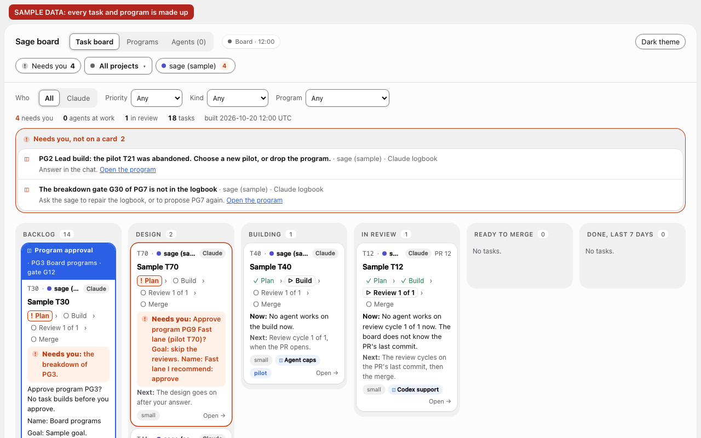

# sage

**sage is a Claude Code and Codex plugin for developers who want a team of agents to build, review and prove their work, while they review results instead of code.**
You say what you want in a session; the agents design, build, review and test it, and you get a pull request with evidence.

<p align="center">
  <a href="https://github.com/erickb336/sage/actions/workflows/check.yml"></a>
  <a href="LICENSE"></a>
</p>

**Status:** early, used every day by its author to build sage itself. Claude Code is supported; in Codex, sage mode and autopilot now work through the sage plugin, and the lead and the board phrases do not work there yet ([sage in Codex](docs/guide/codex.md)). Tested on macOS, and in CI on Ubuntu (Linux); Windows is not supported.

Start with the [Quick start](#quick-start). Then follow one task from start to merge in [Learn sage in 5 minutes](docs/guide/learn-sage.md).

<a href="docs/assets/hero-light.svg">
<picture>
  <source media="(prefers-color-scheme: dark)" srcset="docs/assets/hero-dark.svg">
  
</picture>
</a>

## Why "sage"?

In *Naruto*, a sage stays still to gather natural energy. In Sage Mode, the sage sees and senses more than in normal combat. sage mode works the same way:

- **The chief of staff stays still.** It changes no files. It frames the work, writes the briefs and keeps the logbook.
- **It gathers natural energy.** Here, that energy is the team's work: agents work in parallel, each in its own git worktree.
- **It sees the whole.** It groups the tasks of one goal into a program, makes a task wait for the tasks that it builds on, and gives a mistake that comes back a lasting fix.

The idea of a mode that you turn on by name comes from pstack's **poteto mode**.

And the toad? In the story, toads teach Sage Mode. So sage's mascot is a toad sage: an original drawing of a hooded toad that meditates while its team works.

## Quick start

For Claude Code. For Codex, see [In Codex](#in-codex) below. Before you start:

- Install Claude Code and sign in, with a Claude plan or API credits ([install Claude Code](https://code.claude.com/docs/en/setup)).
- Install Node.js 20 or later (the minimum; CI runs the tests on Node 24), and git.
- Install `gh` and log in (`gh auth login`). sage uses it for pull requests and the merge check.
- Give your project a GitHub remote, if you can: without one, work stops at a verified branch.

1. Install sage, in a terminal:

   ```sh
   claude plugin marketplace add erickb336/sage
   ```

   ```sh
   claude plugin install sage@sage
   ```

   You see `Successfully installed plugin: sage@sage (scope: user)`.
2. Start a new session in a project folder: run `claude`. The first time, Claude Code asks you to trust the folder. A session that was already open does not get sage.
3. Send the on phrase, the words below, as a message of its own, with no other words:

   ```text
   sage mode
   ```

   You see: the chief says that sage mode is on, and waits for your request.
4. Say what you want in the next message, for example `Fix the crash on an empty search.`

   You see: the chief frames the task, asks its product questions in one batch, then brings evidence and a pull request.

To update, run `claude plugin update sage@sage` and start a new session. To stop a task or uninstall sage, see [Using sage](docs/guide/using-sage.md).

> **Warning:** before you use programs (tasks of one goal) or tasks that wait for other tasks, update sage and restart every session that was already open. An older session still merges a waiting task, or a task of a program that you did not approve.

### In Codex

In the Codex CLI 0.160 to 0.164 (the desktop app should work the same way, but it is not checked yet, and it needs the CLI for these commands): run `codex plugin marketplace add https://github.com/erickb336/sage.git`, then `codex plugin add sage@sage`. Start `codex` in a project folder, choose **Trust all and continue** at the "Hooks need review" screen, and send `sage mode` alone ([sage in Codex](docs/guide/codex.md)). You also need Node.js 20 or later, `gh` logged in, and a GitHub remote for the project (see [What you need](docs/guide/codex.md#what-you-need)).

## The board

Send `show board` to see what needs you, the agents at work, and each task in its column. On the Mac, it also starts the board page and gives its address. The board server, and [Remote Control](docs/guide/remote-control.md) (sessions from your phone), need macOS.

<picture>
  <source media="(prefers-color-scheme: dark)" srcset="docs/assets/board-dark.png">
  
</picture>

*Sample data: every task and program in the screenshot is made up. The screenshot shows the first screen of the board on a laptop (1280 by 800 pixels): the project picker, the filters, the Needs you box and the columns, from Backlog to Done. The [board guide](docs/guide/board.md) describes the full board.*

## What to say

Send each phrase alone, as the whole message.

| Say | What happens |
| --- | --- |
| `sage mode` | The session becomes your chief of staff. Send your request next. |
| `show status` | Where each task is: running, waiting for you, verified. It names each open task with no priority. |
| `show board` | The board in the chat, and the address of the board page. |
| `autopilot on` / `autopilot off` | Verified pull requests merge by themselves, or wait for you again. Off by default. |
| `sage mode off` | A normal session again, for the rest of the session. Autopilot goes off too. |
| `sage help` | Every phrase, and whether sage mode and autopilot are on. |

Every phrase, also the board forms, and the exact rules: [Every phrase](docs/guide/using-sage.md#every-phrase). In Codex, the mode phrases and `sage help` work, and the board phrases do not yet ([sage in Codex](docs/guide/codex.md#turn-on-sage-mode)).

## Safety and limits

| sage stops | sage does not stop |
| --- | --- |
| An agent that pushes to main, force-pushes or merges. | An agent that hides a command from the hook on purpose. A sandbox is planned. |
| A merge without its clean review cycles on that exact commit. A task with no review or QA in its route needs only its checks to pass. | Anyone with your GitHub token who removes branch protection. |
| A mode turned on by an agent's text: only your own message turns a mode on. | The cost of many agents: each one is a run on your plan or API credits. |
| In Codex: an unverified merge, a push outside the push form, the chief's own edits in sage mode, a reviewer's plain shell write, any edit under a project's `.codex` folder, a role agent's logbook write, and a new agent or a new Codex session that a role agent starts ([The rules in Codex](docs/guide/codex.md#the-rules-in-codex)). | In Codex: a shell write that hides a `.codex` folder name, for example in a variable; a reviewer's write through `git apply`, `git commit`, a script or `make`; text that an agent types into a shell that still runs (`write_stdin`); anything under full access. |

Every rule and its reason: [Rules held in code](docs/design/rules-in-code.md). Report a vulnerability: [SECURITY.md](SECURITY.md).

## Learn more

- [Learn sage in 5 minutes](docs/guide/learn-sage.md): one small task, from your first message to a merged pull request.
- [How sage works](docs/guide/how-it-works.md): the loops, the team, the routes and a task's life.
- [Using sage](docs/guide/using-sage.md): phrases, questions, update, stop, uninstall and troubleshooting.
- [Concepts](docs/guide/concepts.md), [principles](docs/guide/principles.md), and the [FAQ and credits](docs/guide/faq.md).
- [What's new](CHANGELOG.md): every change for users, newest first, in the changelog.
- [Contributing](CONTRIBUTING.md), and the [docs index](docs/README.md).

## Credits and licence

Built on [pstack](https://github.com/cursor/plugins/tree/main/pstack) and poteto mode by [Lauren Tan (poteto)](https://github.com/poteto). The name nods to Sage Mode in *Naruto*; the drawings are original ([all credits](docs/guide/faq.md#credits)).
MIT licence ([LICENSE](LICENSE)); pstack's text keeps [its MIT licence](upstream/pstack/LICENSE).
