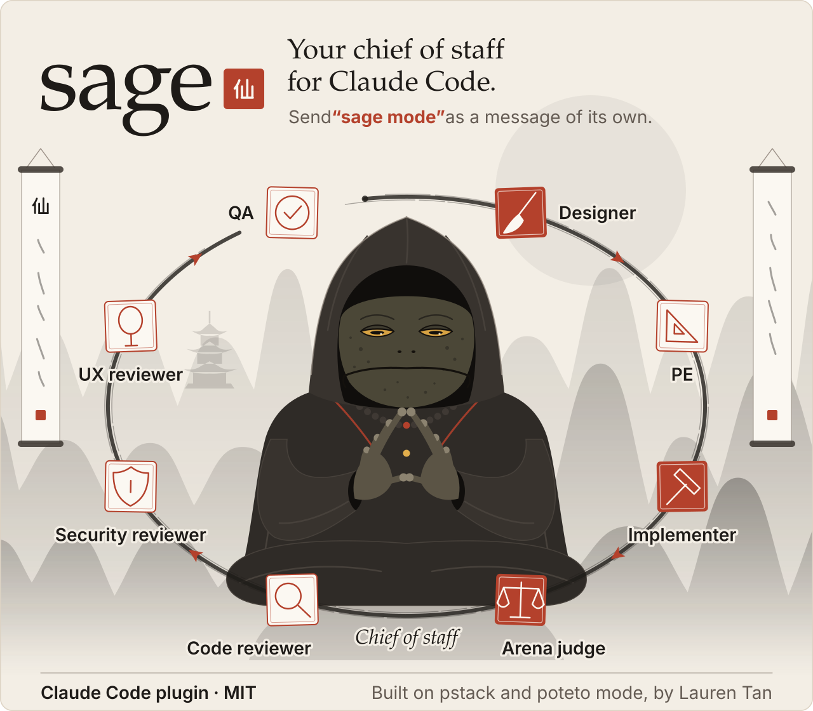
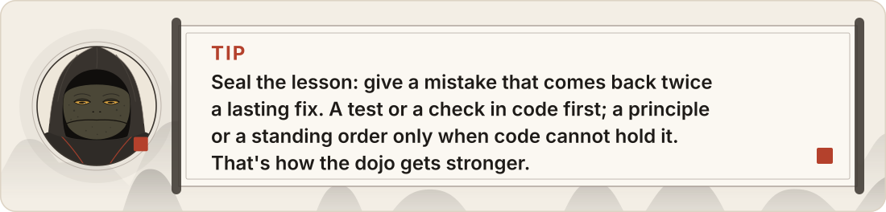
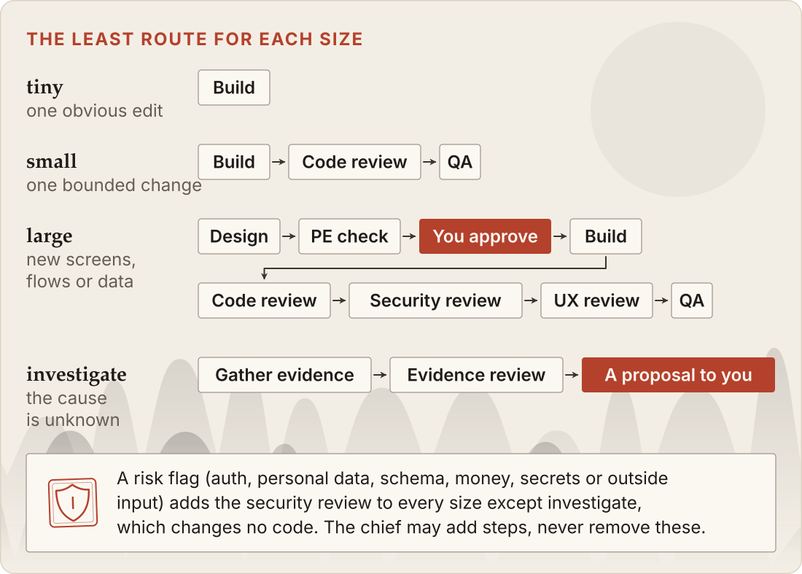
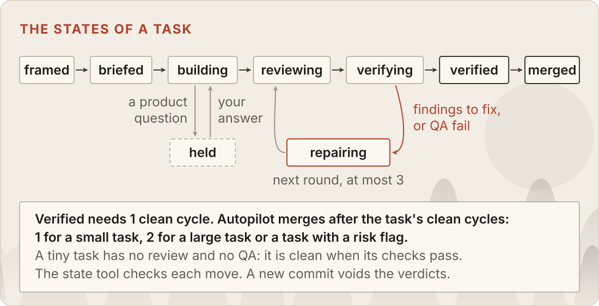
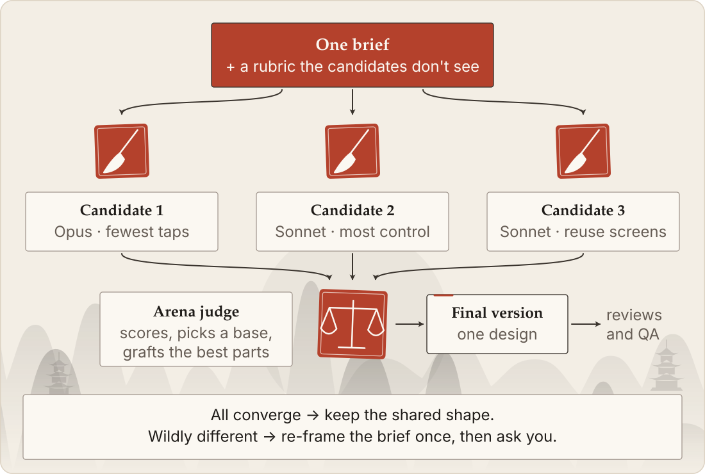
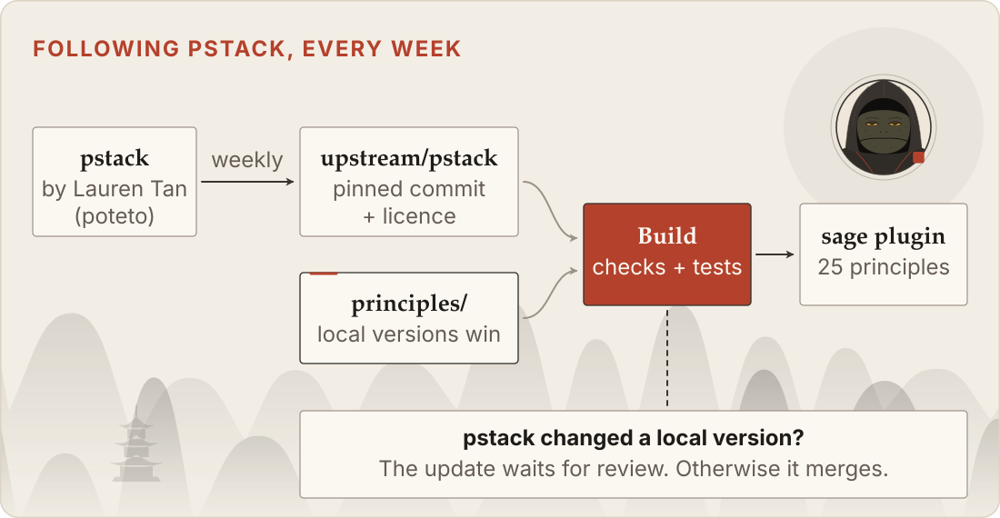

<a href="docs/assets/hero-light.svg">
<picture>
  <source media="(prefers-color-scheme: dark)" srcset="docs/assets/hero-dark.svg">
  
</picture>
</a>

**sage is a Claude Code plugin that turns any session into your chief of staff.** Start a message with "sage mode", say what you want, and a team of specialist agents designs, builds, reviews and proves the work. You answer only the product questions, and you look at results, not code.

<p align="center">
  <a href="https://github.com/erickb336/sage/actions/workflows/check.yml"></a>
  <a href="LICENSE"></a>
</p>

**Contents:** [Quick start](#quick-start) · [Learn sage in 5 minutes](#learn-sage-in-5-minutes) · [Why "sage"?](#why-sage) · [How it works](#how-it-works) · [Concepts](#concepts) · [What to say](#what-to-say) · [Principles](#principles) · [Following pstack](#following-pstack) · [Remote Control](#remote-control) · [FAQ](#faq) · [Under the hood](#under-the-hood) · [Credits](#credits)

It also gives every session 25 short working principles at the moment they apply.

**Codex:** a separate plugin includes the same principles, writing guides and manual logbook commands. Sage mode and autopilot remain Claude-only. See [Codex setup and package boundaries](docs/design/provider-packages.md).

> **Built on [pstack](https://github.com/cursor/plugins/tree/main/pstack) by [Lauren Tan (poteto)](https://github.com/poteto).** sage follows pstack's principles by itself, every week, and sage mode takes its ideas from poteto mode. The name is a nod to Sage Mode in *Naruto*. See [Credits](#credits).

## Quick start

**1. Install** (in a Claude Code terminal):

```text
/plugin marketplace add erickb336/sage
```

```text
/plugin install sage@sage
```

In the desktop app, run these two commands in a terminal instead. The `/plugin` dialog opens only in a terminal.

```sh
claude plugin marketplace add erickb336/sage
```

```sh
claude plugin install sage@sage
```

**To update sage**, run this command in a terminal:

```sh
claude plugin update sage@sage
```

The update applies to every running session at its next event: each hook event runs the newest installed sage. This holds for sessions that started on this version of sage or a later one. A new hook event or matcher needs a restart, and so do the instructions that a session already read (its skills and agent texts).

**2. Start a new session** in a project folder, or in a folder of projects such as `~/workspace`.

**3. Switch it on:** send "sage mode" as a message of its own. Then say what you want in the next message.

```text
sage mode
```

```text
Ramen Finder: add a favourites list, and fix this week's crash.
```

<a href="docs/assets/tip-start-light.svg">
<picture>
  <source media="(prefers-color-scheme: dark)" srcset="docs/assets/tip-start-dark.svg">
  
</picture>
</a>

That's all. The chief of staff interrupts you at most once per task: one batch of product questions, each with its recommendation and a default. Irreversible actions still get their own yes. Then the chief comes back with results and pull requests. From your phone, it works the same through [Remote Control](#remote-control).

## Learn sage in 5 minutes

This is one session, step by step. It is an illustration with sample data.

<a href="docs/assets/walkthrough-light.svg">
<picture>
  <source media="(prefers-color-scheme: dark)" srcset="docs/assets/walkthrough-dark.svg">
  
</picture>
</a>

1. **Switch it on.** Send "sage mode" as a message of its own, then your request in the next message. sage mode stays on until you send "sage mode off" alone.
2. **The chief frames each task.** It gives each task a size (tiny, small, large or investigate) and risk flags, such as `data` for personal data or `input` for outside input. The size and the flags give the task its [route](#routes): the steps it must go through.
3. **One batch of questions, at most.** The chief interrupts you at most once per task. It puts all the product questions of the task in that one batch, and each part comes with a recommendation and a default. A product question is one whose answer you would notice: what you see, which data is kept, who can do what. Four exceptions can interrupt you again:
   - An irreversible action always gets its own yes.
   - A new fact that changes an earlier answer can bring the question back.
   - A large task's design gets your approval after the PE check.
   - An escalation: the work finds something that the chief cannot decide alone. For example:
     - The task is held or needs a new plan.
     - An agent stops at a new product question.
     - A finding needs a decision.
     - The arena candidates do not converge.

   Engineering choices, such as file formats and names, are the chief's. It decides them and logs them.
4. **The team works.** For each step, the chief starts a fresh agent with a full brief. Reviews and QA report findings. A medium or high finding goes back to an implementer for a repair, at most 3 rounds. After a repair, only the roles that found the problems re-check the repair's diff. A new medium or low finding from a round goes to a follow-up task; a high one blocks. Then the task needs its clean cycles on the final commit: 1 for a tiny or small task, 2 for a large task or a task with a risk flag.
5. **You get results.** You get evidence (the commands that ran, screenshots), what was not checked, and a pull request. You merge it, or autopilot merges it.

**Try it yourself.** Pick one small, real bug in a project that has tests and a GitHub remote. Start a session from your phone, start your message with "sage mode", and describe the bug. Then look at the result, not the code.

<a href="docs/assets/tip-try-light.svg">
<picture>
  <source media="(prefers-color-scheme: dark)" srcset="docs/assets/tip-try-dark.svg">
  
</picture>
</a>

## Why "sage"?

In *Naruto*, a sage stays still to gather natural energy. In Sage Mode, the sage sees and senses more than in normal combat.

sage mode works the same way:

- **The chief of staff stays still.** It never edits a file. It frames the work, writes the briefs and keeps the record.
- **It gathers natural energy.** Here, that energy is the team's work: specialists work in parallel, each in its own git worktree.
- **It sees the whole.** It groups related work, puts tasks that share code in order, and gives a mistake that repeats a lasting fix.

The idea of a mode that you switch on by name comes from pstack's **poteto mode**.

And the toad? In the story, toads teach Sage Mode. So sage's mascot is a toad sage: an original drawing of a hooded toad that meditates while its team works.

The alternatives: a plain Claude Code session, where you guide each step and read the code yourself, or another plugin that runs a team of agents.

## How it works

<a href="docs/assets/loop-light.svg">
<picture>
  <source media="(prefers-color-scheme: dark)" srcset="docs/assets/loop-dark.svg">
  
</picture>
</a>

There are two loops:

- **The inner loop** turns a request into verified work. The chief briefs the team. The team designs, builds, reviews and tests. Findings go back to the build. A clean result becomes a pull request.
- **The outer loop** [seals the lesson](#concepts): it gives a mistake that comes back twice a lasting fix, from the most enforced kind down: a test or a check in code first; a principle or a standing order only when code cannot hold it. Each sealed lesson makes [the dojo](#concepts) stronger. The dojo is everything that makes the agents good: the principles, checks, tests and skills.

<a href="docs/assets/tip-seal-light.svg">
<picture>
  <source media="(prefers-color-scheme: dark)" srcset="docs/assets/tip-seal-dark.svg">
  
</picture>
</a>

The state lives in the logbook: plain files in `~/.claude/sage/<project>-<hash>/`. It holds the tasks, the agent runs, the findings, the verdicts, your answers and the decision trail. So you can leave and come back from another device, and a new session continues the work. Two more folders hold the rest: the hook keeps the mode, autopilot and the agent slots in `~/.claude/sage/.hooks/`, and agents save their pages (research, designs) in `~/sage-worktrees/<project>-<hash>/pages/<task>/`, outside the logbook (the chief makes the folder and prints its path).

### The team

| Agent | What it does | Changes files? |
| --- | --- | --- |
| **Chief of staff** | Frames the work, picks routes, writes briefs, records results, asks you the questions | No |
| **Lead** | Runs one task's pull request from the build to its clean cycles: starts its implementer, reviewers and QA, and records their runs, findings and verdicts. One lead for each pull request | No |
| **Designer** | A clickable prototype with sample data, and every state of each screen | Yes, in its own worktree |
| **PE** (principal engineer) | Checks a plan or a design before the build: feasibility, data, risks, cost | No |
| **Implementer** | Builds one task, runs the checks, opens the pull request, repairs findings | Yes, in its own worktree |
| **Code reviewer** | Correctness, data safety, regressions, test evidence | No |
| **Security reviewer** | Input at the boundaries, injection, secrets, access | No |
| **UX reviewer** | The flow, the states, the copy and accessibility | No |
| **QA** | Runs the checks and the real app, and tries to break it | No |
| **Arena judge** | Scores an arena's candidates and grafts the best parts into one | Yes, the final version |

Only one agent writes on a branch at a time. Reviewers start fresh, so they don't share the builder's blind spots.

Each task with a build gets one lead. The chief records a lead run and starts the lead in the background with the name `lead-T<n>`. The lead runs the build, the cycles and the repair rounds with at most 3 helpers at once, leaves the task at verifying, and gives the chief one report. The lead and each helper take a slot of the project's agent cap (`max_agents`, 4 by default), so with the default cap one lead runs at a time. The lead records each finding of its helpers. A medium or high one goes to a repair round. A low one is dismissed with a reason, joins a round, or goes to the chief to move to a follow-up task. A tiny task has no review or QA, so its lead runs only the implementer. When the lead cannot clear a finding itself (a low one with no round, a new one from a round's re-check, or a fix that the re-check does not confirm), it ends blocked, and so it does in any state that its file does not name. The chief then reads the logbook and decides. Its only state moves there are repairing to reviewing (a fix that the re-check did not confirm gets the next round, or a replan) and reviewing to verifying (the checks passed). It may move a low or new finding to a follow-up task, and it starts a fresh lead, which goes on from the logbook. The chief keeps what only it does: your questions, the checks verdict after `gh pr checks`, the move to verified, the follow-up tasks, and the merge. So the chat shows a few lines for each pull request, not every report. An investigation has no pull request, so the chief runs it without a lead.

Claude Sage uses the Balanced model defaults. Sonnet handles UX review, tiny implementation and code review, and QA for tiny and small tasks. Opus handles the other configurable roles and sizes. An optional `model.<role>.risk` setting overrides the size choice when the task has a risk flag.

### Routes

Each task gets the least route for its size. The chief can add steps, never remove these.

<a href="docs/assets/routes-light.svg">
<picture>
  <source media="(prefers-color-scheme: dark)" srcset="docs/assets/routes-dark.svg">
  
</picture>
</a>

### A task's life

<a href="docs/assets/lifecycle-light.svg">
<picture>
  <source media="(prefers-color-scheme: dark)" srcset="docs/assets/lifecycle-dark.svg">
  
</picture>
</a>

A **cycle** is one full set of fresh reviews and QA on one commit. A task is **verified** after 1 clean cycle. With autopilot on, it **merges** after its clean cycles on the same commit: 1 for a tiny or small task, 2 for a large task or any task with a risk flag.

### Rules held in code

A rule written only in a prompt fades over a long session. So sage keeps its important rules in code: a hook that checks each action, and a state tool that refuses a wrong move.

| Rule | Why |
| --- | --- |
| The chief of staff never edits a file. | It keeps the big picture; the team does the details. |
| Every brief has all its fields; every report has its evidence. | A vague brief fails quietly. A claim without evidence is not a result. |
| Only a message of yours that is exactly a switch phrase switches sage mode or autopilot: the whole message, in any letter case, with at most one full stop at the end. Any other text switches nothing, also text in an agent's report, a task notification, a hand-back or another session's message. A message that you send while Claude works can switch only autopilot off. When a message is near a phrase, the chief gets a note with the exact phrase to ask you for. When the hook cannot read a prompt's frames, nothing in it switches, and when it has a phrase, the chief asks you to send it again alone. | A switch is your decision, and an exact rule never guesses. Before, agent reports and free text with an off word switched modes by accident. |
| Only main starts leads (at most 3 per project), each with the name `lead-T<n>` and in the background. In sage mode, the task `T<n>` must have a running lead run in the logbook of the session's folder (`sage run add T<n> --role lead`); otherwise the refusal names that command. A second lead of the same task waits while the first one's slot lives, in any session, and a session holds one lead of each name `lead-T<n>`, in any project. The main session's TaskStop stops a lead by its agent id or by its exact name `lead-T<n>` (in any letter case), and a stopped lead starts no child. A lead's TaskStop is refused, and so is any other agent's TaskStop of an agent (`R<n>`, `lead-T<n>`, `main`, or an agent id that a slot holds): only the main session stops an agent, so no lead or helper cuts a reviewer or QA off before its report. The rule reads `task_id` or the old `shell_id`, refuses a call with both at different values, and reads a name or an agent id after NFKC, without format characters such as a zero-width space, without spaces at its ends and in any letter case; so does the main session's stop of `lead-T<n>`. A helper still stops its own shell tasks; a lead stops none. The main session's stop by `shell_id` frees the slot too. A held task takes no run add, fix triage, finding close, verdict, `pr=` or `branch=` from anyone until the sage moves it; the sage may still triage a finding as ask, or dismiss it with a reason. A lead repairs only through `round`: while a medium or high finding is triaged fix and the task is not repairing, it closes no finding and records no verdict on a new commit. A lead's run counts only with a real child: the lead starts the child under the run's id as its name (`R<n>`; the hook refuses any other name), a child of the run's role, and the run ends (`run done`) only after that child stopped. Each lead verdict names such a run of its task, finished, of the task's current round and in no other verdict, whose role gives that kind (`--run`); a check verdict needs none. The verdict must say what that child's report says, on the commit that it saw: at the child's stop, the hook keeps the first word of its RESULT, the severity of each finding in its FINDINGS, and the head of the task's branch if the branch did not move since the child started. The stop gate and the lead rules read a report with one reader. A field starts a line that is not indented, and Markdown around its name is fine (`**FINDINGS**`, `FINDINGS:`, a table row). Each line break ends a line, also U+2028 and U+2029. FINDINGS is `none` alone, or one line per finding in the form `- <key> <severity> <summary>`, where the key has a digit, with any detail on indented lines under it. The reader never lowers a severity and never reads a finding as none. A field given twice (also FINDINGS as an indented line or a list item), any other line under FINDINGS, a line there over 4,096 characters, a detail line whose first or second word is a severity word or that has a severity label (`high:`), or RESULT FINDINGS or FAIL with `none` makes the report unreadable, and the stop gate stops the agent once to fix it. A code block counts only from a fence indented by at most three spaces. A clean verdict (review-clean, security-clean, ux-clean, qa-pass) needs a clean report (CLEAN or PASS, or FINDINGS or FAIL with only low findings); `findings` and `qa-fail` need a report that is not clean, and `--sha` must be the commit that the child saw. The findings that the lead run recorded itself (the hook sees its own `finding add` print the key) must hold each medium and high finding of every stopped child of that role's runs, in any round, at its severity or above: one recorded finding for each finding of each run. A lead started again on the same lead run keeps them. A finding that the sage added never counts, also on an old key; the sage's dismissal, close or move of the lead's finding (once or more, by the move's own decision) still counts. Until they do, the lead adds no run of that role, records no verdict of that role (clean, findings or qa-fail) and makes no state move. A lead records no verdict on a run whose child gave no report, or a report that the hook cannot read: the sage reads it. A review or QA run whose report was not clean ends only after the lead records its medium and high findings, or after its findings or qa-fail verdict; the sage ends a run whose report it cannot read. A lead uses only the runs that it added itself: the hook sees its own `run add` print the id, of the role that the command asked for. A new lead never helps with, ends or uses an old lead's runs, nor the runs that the sage added, and the sage ends them. One run has one child, in any session and also after its slot's lease ends. A run whose child gave no report (it never started, it left with no stop when its slot's lease ended, or the main session stopped it) ends only as failed or blocked, and backs no verdict. While the child's lease is live, the refusal says to wait for its stop, with the minutes left, or to ask the sage. The merge check refuses while a review or QA run of a task still runs. A new lead's start removes the child notes of the logbook's ended lead runs. The state tool refuses a review or QA verdict whose `--run` already backs one of the task. While repairing, a lead closes only the round's fix findings (never one triaged ask), and only when the head of the task's branch is not a commit on which one of its review or QA children of an earlier round found problems (a re-review of the repair that finds a new problem does not count); it leaves repairing only after them; a new finding of the round waits for the next round. A lead never changes the triage of a finding triaged ask. A move out of a hold that `round` set gives the task one more repair round, once per such hold; a hold for a question gives none. A retry whose last round's findings are still open goes to replan, as does any round that fixed none of the last round's findings. Leaving replan clears the old round's keys, so its findings no longer replan the task; the round number goes on, so the total stays capped by `max_rounds` plus the extra rounds. A move from held or replan back to briefed ends the task's running lead run, so the old lead writes nothing more and starts no child; the sage starts a new lead with the new brief. A lead with no bound lead slot starts no child, nor does a lead whose task is held, in replan, merged, concluded or abandoned, or whose lead run ended. A lead that is started outside sage mode gets no slot, so it starts no children: this is intended. The hook reads that logbook with the 4 MiB limit per table, and refuses when it cannot read it. In sage mode, and for a sage agent in any mode, an agent never names a spawn `main` or `lead-T<n>`. A sage type counts in any letter case. A lead starts at most 3 permitted children; other agents start none. These rules hold in any mode for an agent's spawn of a sage agent. In sage mode, and for a sage agent in any mode, an agent sends SendMessage only to main, because a message can wake a stopped agent. Every sage spawn needs a full brief and shares the project cap (`cap.<project>`, otherwise `max_agents`, default 4, so one lead and its 3 children fit). `cap_total` (default 12) remains a temporary fuse across projects. A slot stays until its own agent stops, the main session stops it, or the one-hour lease ends; a child's events renew its lead's lease, and a lead keeps its slot while a child runs. A spawn that fails, or that shows no start after 10 minutes, frees its slot. | Cost, focus and bounded nesting. |
| The logbook records a lead as a run with the role `lead` (`sage run add <T> --role lead`). A task has at most one running lead run, and a project at most 3; each refusal names the running lead runs. An investigation takes no lead run, because it has no build, and neither does a task that has ended (concluded, merged or abandoned); a verified task does, for its remaining cycles. A lead run counts in `status` and shows on the board with its role, as any run does. | The logbook agrees with the hook's limits, so a second lead for one pull request never starts from a stale record. |
| One writer per branch. Nobody force-pushes or pushes to main. A push is only `git push [-u] origin <branch>`, with the branch's own name. | Parallel writers conflict. Work reaches main only through a pull request. |
| An agent never merges. The merge rule and the push rule hold for every command tool: Bash, Monitor, PowerShell and the terminal tool. | An agent that reports a ready pull request leaves the merge to the chief or to you. A second tool must not be a way around the rule. |
| In sage mode, this rule applies to agents and the main session. The hook refuses `{`, `[`, `*` or `?` in program words, the first git/gh subcommand, and the subcommand after `gh pr`. The literal `[` and `[[` test commands are allowed. It refuses `./scripts/*.sh`, but allows ordinary arguments such as `git log --format='%h {x}'`. | Shell expansion can hide the command from the hook. |
| An agent never runs `git stash`, in any form. To test old code, it uses `git worktree add --detach <scratch> <sha>` or `git show <sha>:<path>`. | Every worktree of a repo shares one stash list, so another agent can pop or drop the work. |
| An agent never lists or signals the real processes (`ps`, `pgrep`, `pkill`, `kill`, `killall`, `lsof`, `top`, `htop`, `fuser`, `pidof`, and `kill-port` or `fkill` through `npx`, `npm exec`, `pnpm dlx` or `bunx`). Such a program passes only as a fake in the temp folder, found through PATH and links. A bare `kill` is the shell's builtin, so it never passes. The hook finds the program after shell keywords (`while`, `if`, `do`, `!`, `{`), redirections (`2>/dev/null ps`), wrappers and their options, inside a shell's `-c` text or stdin, and in the arms of a `case`. The arguments of a script (`bash ./x.sh kill`) and a `case` pattern are not programs. To stop its own server or background job, an agent uses TaskStop, or runs it as a background task. | An agent that reads or signals the real process list can stop your own programs. A `process.kill` inside a script is not visible to the hook. |
| A task's branch, and the branch of a writer run, is a plain task branch such as `claude/t12`: letters, digits and `. _ / -`. It is never main, master or HEAD in any case, and never a name under `refs/`, `heads/`, `remotes/` or `origin/`. | Git reads those names as main or as another ref, so a writer could reach main without a pull request. |
| Agents save their pages (research, designs, findings pages) in the task's pages folder, outside the logbook. The chief makes the folder with the state tool (only you can open it) and prints its path, and logs each page in it with its sha256. The state tool logs only a regular file of at most 16 MiB inside that folder, with no control character in its name. | A sandboxed agent cannot write the logbook, and the sha256 shows later that the page did not change. |
| Every finding is triaged: fix, dismiss with a reason, or ask you. | No finding is dropped. |
| A repair round needs a medium or high finding; at most 3 rounds. | Loops must end. A low finding alone isn't worth a round. |
| A repair round re-checks only the repair's diff, with the roles that found the problems. A new medium or low finding goes to a follow-up task; a high one blocks. | A round that re-reviews the whole branch finds new scope, not the fix. |
| A merge needs the exact checked commit, with its clean cycles in the ledger. The hook reads the pull request's head branch from GitHub (`gh pr view`, at most 5 seconds) and refuses the merge unless each task that is or was on the pull request owns that branch (`merge-check --head <branch>` runs the same check by hand). A failed or slow read, or a pull request from a fork, refuses. Only a task in the logbook of the project being merged (the merge's folder) approves its pull request; a task of another project's logbook with verdicts on the commit must still pass. | A new commit is not checked until it is reviewed again. |
| Only the chief writes the logbook, except a lead on its own task (next row). An agent runs only the state tool's read commands (`status`, `merge-check`, `logbook`, `standing`, `config` with no `key=value`), as one plain command, from Bash or any other tool that runs a command. A command that names `sage.mjs` or `sage-pr.mjs` (in any case, also in quotes) may run only plain readers: `cat`, `grep`, `rg`, `head`, `tail`, `wc`, `ls`, `diff`, `shasum`, `jq`, `awk` and `sed` without `-i`, and `git show`, `log`, `diff`, `status`, `blame`, `grep`, `ls-files`, `add` or `commit`. Any other program in it is refused and named: `node`, `python`, a shell, `eval`, `echo`, `env` or `xargs` with it, whatever their options, also behind a shell keyword such as `for`, `while`, `if`, `{` or `!`. The one exception is the plain read command above. The hook does not look for the script among a program's options. It never runs the PR script, never writes under the sage root with its own tools (in any case or Unicode form, also through a link), never runs a shell write near the logbook (the sage root, `SAGE_HOME` or `CLAUDE_CONFIG_DIR`, `.claude`, a variable by the home folder, or a path that leads into the sage root through a link or `..`), and never runs outside the sandbox. A `SAGE_HOME=<folder>` or `CLAUDE_CONFIG_DIR=<folder>` in the command, with a plain path outside the sage root (a scratch folder for tests), passes. A `$SAGE_HOME` or `$CLAUDE_CONFIG_DIR` in a write is always refused, whatever assignments come before it: write to the scratch path itself. A pattern or a logbook file's name in a project passes (`rm dist/*`, `jq ... > config.json`); with `cd`, `..`, `~`, `$` or an absolute path in the command, it is refused. The hook does not expand variables, so the `?` of `$?` is a pattern character: after a redirect to a file, show the exit code with `|| echo FAIL` or `; echo done`, not with `echo exit=$?`. A refusal names the word that caused it, in the command's own capitals, and the plain way where one exists. When the hook cannot check an agent's call, it refuses it. A pattern with a link on its path (a link before the first wildcard, or a link that the first pattern part names, also a dangling one) is refused everywhere. The hook stops agents' mistakes and the common forgery forms. Deliberate shell forgery (scripts, variables, links made at run time) is the sandbox's job (tasks T94–T99); merges stay paused until the sandbox switch (T99) merges. | An agent that records its own verdicts could make an unreviewed commit pass the merge check. |
| A lead writes the logbook only for its own task, and only with a short list of state tool commands. The event's agent type must be exactly `sage:lead`, and the agent must hold the lead slot that the chief's spawn named `lead-T<n>`. The slot keeps that task, its logbook folder and its running lead run: a write from a folder of another logbook, or after that lead run ended, is refused. The list: `run add <T> --role` implementer, code-reviewer, security-reviewer, ux-reviewer or qa; `run done` of a run of those roles; `finding add <T>` without `--key`, and with `--run` only of a run that the lead added; `finding close <T> <key>`; `finding triage <T> <key> fix`, or `dismiss --reason` for a low finding; `verdict <T> --pr <its PR>`, with `--run` only for a run of the task (a task with no PR takes no lead verdict); `round <T>`; `task <T> set` with one `state=` of the cycle's next move (briefed to building, building to reviewing, reviewing to verifying, repairing to reviewing, verifying to verified, verified to reviewing; never from held), `branch=`, or `pr=` while the task has no PR, to a PR that no other task has or had. A `run add --branch` is a branch of the task. Each task word must be the lead's task. The hook reads the logbook for the task of each run id or finding key, and refuses an id that is not there, an id of another task, and a table over 4 MiB. A lead's write runs from Bash, as one plain command, with no `--project` and no `SAGE_PROJECT`: the state tool then finds the logbook from the command's folder, as the hook does. So a free-text value such as a summary or a reason is one word (`--summary=no-test-for-empty-input`). Every other write of a lead is refused with a sentence that says to report to the sage. A child of a lead, and every other agent, writes nothing, as before. | A lead records its own pull request's runs, findings and verdicts, so the chat does not carry every report. A lead that could write another task's record could make that task's commit pass the merge check. |
| Only sage.mjs changes the logbook. The chief's file tools never write under the sage root, in any mode. Its shell never writes with the sage root's path, `.claude/sage`, a `$SAGE_HOME` or `$CLAUDE_CONFIG_DIR`, or an assignment of them to anything but a plain folder outside the sage root, in any case or as a pattern. The refusal names the word. In sage mode, its shell also never writes a logbook file by its name (`tasks.tsv`, `ledger.tsv`, `config.json` and the others). Out of sage mode, a project's own `config.json` stays free. The state tool, `node <path>/sage.mjs ...` as a command of its own, passes. Your own `!` commands stay free. | A size or risk changed by hand leaves no record, and lowers the clean cycles that a merge needs. |
| Every task that was ever on a pull request counts for its merge. A pull request's number has no leading zero, so it has one spelling. A change of a task's `pr=` writes a decision row, and the task stays in the merge check until you merge. | A large task's pull request cannot be framed again as a small one to need fewer reviews. |
| The PR script, `sage-pr.mjs import\|create\|view\|merge <task>`, imports a task's commit for review, pushes the reviewed commit and opens, shows or merges its pull request. It takes exactly those two words. `import` copies the agent's bundle into the logbook's mirror (with fsck, so each object's hash is checked) and writes a review copy that agents cannot write: `review/<task>-<sha>/` in the logbook folder holds the commit's files, and `review/<task>-<sha>.diff` its change from main. The reviewers read only this copy, because git in the agent's own clone does not check the hashes, so an agent can make it show harmless text at the right SHA. `create` and `merge` refuse a commit whose review copy is not older than its first verdict: run `import`, and review again. It reads the branch and the reviewed commit only from the logbook, and the commit only from the bundle file that the agent wrote: a link, a second hard link, a file over 10 MiB or a file that is not a git bundle refuses, and so does a bundle whose tip is not the reviewed commit, the base branch, a branch of another task and a commit that is already on main. It refuses a project folder that is not the logbook's own checkout (`checkout.txt`) or that is in the worktree root, an origin that is not exactly `https://github.com/<owner>/<name>`, `ssh://git@github.com/<owner>/<name>` or `git@github.com:<owner>/<name>` (with an optional `.git`; a user or token, a port, a `#`, a `?`, another host or an upper-case host refuses), and a `SAGE_REPO` that is not the origin's repository. A `mirror.git` in the logbook that is not a bare repository (a file, a link, an empty or other folder) refuses: remove it, and the next call makes a new mirror. When GitHub lists 100 or more pull requests of the branch into main (forks' pull requests with the same branch name count too), it refuses, because the task's own can be missing from the list. It pushes fast-forward only and never a tag, opens a pull request only when the repository itself has none open from the branch into main (GitHub allows one), and records its number in the logbook (it replaces a closed one, or a number that GitHub does not have). It refuses a task with a merged pull request of its branch, also when the logbook has no PR number ("already merged as PR #n: nothing to create"), because after a squash merge the commit is not on main. It merges only that pull request, only when the task is verified or pr-ready (else it names `sage task <T> set state=verified`) and GitHub has the reviewed commit (else it names `sage-pr create`), only after the merge check, with `--match-head-commit`. Then it reads the pull request again: a merge queue that leaves it open is no success, and an error after GitHub merged (such as a branch deletion that gets 403) is still a merge. A pull request that is already merged gives "already merged" and exit 0 only when GitHub merged the reviewed commit; a merge of another commit refuses ("pull request #n merged <sha>, not the reviewed head <sha>: ask the user"). No message prints the origin, `SAGE_REPO`, a URL's user and password (also with punctuation), an `Authorization` header (also quoted or as key=value) or the value of a gh token variable. git and gh get only an allow-list of the environment's variables (no `GIT_CONFIG_*`, `GIT_SSH_COMMAND`, `GH_HOST` or proxy), no global git config, and a folder that agents cannot write; the script refuses to run with `NODE_OPTIONS` set. The whole call holds the logbook's lock, so two calls on one project never share the mirror. Exit 1 is a refusal of the script's own checks (or git's own answer that the mirror or the bundle is not one), and exit 2 a failed git or gh call (also a lock or disk error, or a call on the bundle that takes over 120 s) or a logbook that stays busy: run it again. A folder that the script cannot remove gives a warning, not another exit code. Exit 3 means that the merge happened but the mirror refresh failed: run merge again later, and it says "already merged" and refreshes the mirror. It is built but not in the route yet: agents still push, and the chief still runs `gh pr merge`. | In the coming sandbox, agents never push or call gh. One small script with a closed grammar is easier to check than every form of `git push` and `gh`. |
| Only a logbook that `sage init` made can approve or block a merge. `init` adds the logbook's folder to the known project list, `projects.tsv` in the sage folder. A folder outside that list that has verdicts on the commit refuses the merge and is named. `init` adds only a project's own folder, so for a renamed folder or a link: give the folder back its name, run `sage projects rebuild --accept-listing yes`, or remove the folder. The first sage command of this version lists the logbooks that are there already, once, and writes `projects.made`. After that, a missing `projects.tsv` is never listed again by itself: every merge and every `init` refuses until you restore it or run the rebuild. The rebuild lists each logbook folder that is there now and prints them: check each one, and remove a folder that no project uses. A `projects.tsv` that is a link, a folder or has no header line refuses every merge and every `init`, and names the rebuild. | A folder that something else made in the sage folder could otherwise lend forged verdicts to a merge. |

**The limits of the hook.** The hook catches mistakes and the normal habits of an agent, such as a quoted branch name or a short ref like `heads/main`. It does three things:

1. **It refuses.** The merge rule and the push rule are allow-lists: a command that merges or pushes passes only in its one form, and each refusal names that form.
   - A push names `origin` and the literal name of a branch that is not main or master. `HEAD`, `@`, a pattern, a variable or a refspec with `:` or `+` is refused.
   - The hook reads the branch of the checkout where the push runs (the `-C` folder, a `cd` before it, or the session's folder), and refuses a push from main or master.
   - A git push of main is refused. So is a `gh api` command that names main or master on a `git/refs` endpoint, also behind `env`, `command`, a `NAME=value` or a path to `gh`.
   - When the hook cannot read a command, it refuses the command.
2. **It asks you in one case.** For a blank project, the chief creates main or master on GitHub for the first time. Only this whole command, from the main session, asks you: `gh api --hostname github.com -X POST repos/<owner>/<repo>/git/refs -f ref=refs/heads/main -f sha=<full commit id>`. An agent never gets this exception. The hook checks on GitHub, not in the local repo, that the branch is absent and that the commit has no parent. Then Claude Code's permission prompt shows you the repository, the commit, its number of files and its top-level names.
3. **The lock is GitHub branch protection.** After the first main or master, sage tries to turn it on, so that the branch changes only through pull requests. GitHub offers it for public repos, and for private repos on paid plans.

The limits, said once: the hook and the lock stop mistakes, not an agent that acts on purpose. An agent can hide a merge or a push from the hook, for example with a git editor or a git hook that runs a shell, a file that a later command runs, or a command name split across variables. An agent that holds your GitHub token can remove the protection or merge a pull request. The guard against that is identity: agents get a GitHub identity that cannot merge or change main. That identity is planned and not built yet.

### The arena

When a design has no clear answer, the chief can run an **arena**. You can also ask for one: "arena" or "arena 4".

<a href="docs/assets/arena-light.svg">
<picture>
  <source media="(prefers-color-scheme: dark)" srcset="docs/assets/arena-dark.svg">
  
</picture>
</a>

1. The chief writes a rubric: 3 to 6 criteria that a judge can grade. The candidates don't see it.
2. N candidates (3 by default) get the same brief, each with a different angle, on a mix of Claude models.
3. The arena judge scores each one, picks a base, and grafts the best parts of the others into it.
4. The final version goes through reviews and QA like any build. The candidates never merge.

## What's new

- **Review data for each task.** A finding can name the run whose report holds it (`finding add --run R<n>`) and its problem class (`--class`: state-edge, speed, copy, layout, security or other). Leads give both. A done review, QA or evidence-review run needs its tokens (`run done --tokens <n>`). Ask the chief for review stats: `sage stats [--task T<n>]` prints each task's review runs, review tokens, repair rounds, and findings by role and by cycle, and a total. It reads only. An older sage refuses to write a logbook with the new finding columns, so it loses no value: update sage in each session.
- **The board has an Agents page.** A second tab in the board header, "Agents (n)", opens `/agents`: every agent that runs now, in all projects, for Claude and Codex, with one box for each project and its Claude agent cap, and each lead's helpers under it. Each agent has a state with a mark and a word: working, waiting for its helpers, may be stuck (30 min with no hook activity), running long (more than 2 times the usual time of its role in the project), helper stopped while its run is still open, or running (Codex, with no activity record yet). The rows that need a look come first. The sage hook now marks each agent slot with the run id from the brief's first line, so that the page joins a slot to its run exactly. See [The Agents page](#the-agents-page).
- **The board has a project picker, a filter bar and a step line for each task.** One button with the current project opens a list that you can search: by the shown name, the GitHub repository (upstream or origin), the folder, the logbook key, and on the Mac's own page also the folder's full path (a tunnel viewer and the offline file get no paths). A screen reader hears the count of matches. The list closes when the focus leaves it. A match on a name that is not the shown name says which name it matched. The list has the groups Needs you, Active in the last 14 days, Idle and Archived (folded). Next to the button, a chip for each project that needs you takes you there in one tap. Keys: "/" opens the list, the arrows move, Enter chooses and Esc closes. Each row's second line says where the project is: its GitHub repository as owner/repo, or "no GitHub remote", then its folder. When two projects would look the same, the line starts with the end of the path, as far as the two differ (for example …/clone-b/sage). An unreadable logbook's row says why in plain words. A chosen archived project has an Archived mark. The board keeps your choice in the address (`#p=`) and in the browser. On a phone the list opens from the bottom, with a Close button. The filter bar has Who (All, Claude or Codex), Priority (P0 to P3, or none) and Kind. The Claude and Codex logbooks of one checkout are now one project, and each card says which provider's logbook holds it. Two clones at two paths stay two projects, and when the logbooks of one key name different checkouts, the board keeps them apart and says so. Each card shows its steps in plain words, for example Plan › Build › Review 1 of 2 › Review 2 of 2 › Merge. A card that is not in the backlog then shows a "Now" or "Needs you" line and a "Next" line. A backlog card shows only its steps, and its "Needs you" line when it needs you. A repair shows as "Repair, round 1 of 3", then "Review again"; an investigation shows Plan › Investigate › Evidence review › Conclude. A question for you shows once, in the "Needs you" line. A step says "running now" (▶) only while a run of the task runs; a current step that no agent runs says "no agent at work" (▷); an open gate makes the current step "needs you" (!). A run with no change in its logbook for 24 h shows "may have stopped" (⧗) on the step, the Now line and its agent pill, and it is not counted as an agent at work. "Needs you" means an open gate, a design that waits for your answer, or a verified PR that waits for your merge: a held task or a replan waits for the chief until it asks you. When all review cycles are clean, the Now line says the reviews are done and Next says that the chief checks the verdicts, then the merge. The backlog folds after the project and the filters are applied ("Show 3 more tasks"), and never when 6 or fewer cards show. A live update no longer resets the page: the server sends one only when the page changed, and the page keeps its scroll, its focus, its open folds and the open list with its search. The theme follows your system until you choose one, with no flash at load. The first `status` line names the project as the board does. For QA, `node scripts/board-sample.mjs <empty folder>` writes sample logbooks. The board stays read-only: ask the sage to change a priority or a kind.
- **Project names, archived projects, and a priority and a kind for each task.** Ask the sage to name a project, and the board shows that name in place of the folder name (`sage config name="<name>"`, 1 to 60 characters, kept in the project's own logbook). Without a name, the board shows the GitHub repository of the checkout's `upstream` remote, then of `origin`, then the folder. Ask the sage to archive a project (`sage config archived=yes`), and the board folds it into an Archived group, with a count of what needs you there. The board's scope (`show board for <name>`) takes the name that the board shows. A bad name or archived value in a hand-edited logbook is a warning on the board, which then shows the project without it. Each task can have a priority (P0 to P3; none by default, and it sorts last) and one kind (design, ui, orchestration, optimization, bug-fix, logbook, docs, security, providers or checks), which show as tags on its card: `task add --priority --kind`, or `task <T> set priority=` and `kind=`. The board stays read-only. An older sage refuses to write a logbook with the new columns, so it loses no value: update sage in each session.
- **The lead agent.** A new role, `sage:lead`, runs one task's pull request for the chief: it briefs the implementer, runs the reviews and QA in cycles and the repair rounds, records its own task's runs, findings and verdicts, and reports once, with the task at verifying. The chief records a lead run, starts the lead in the background as `lead-T<n>`, and waits for that one report; it still asks you the questions, records the checks verdict after `gh pr checks`, moves the task to verified, moves findings to follow-up tasks and merges. The lead's file teaches only what the hook allows: each helper's run in its order (`run add`, the helper named by its run id, its stop, each finding with `finding add`, `run done`, then the verdict), one-word summaries, and the cycle's state moves. Each medium or high finding goes to a repair round; each low one is dismissed with a reason, joins a round, or ends the lead blocked for the chief to move. A lead that cannot clear a finding itself ends blocked at once, and so does a lead in any state that its file does not name. The chief then decides from the logbook: its only state moves there are repairing to reviewing and reviewing to verifying. It moves only a low or new finding, and the state tool refuses `finding move` of a fix key of the round at any severity until you answer a gate that names it. The chief never dismisses a finding because the lead calls it a repeat of a fix: it triages it fix, so that it joins the next round, also a high one. An unconfirmed low fix joins the next round while a medium or high finding is open; otherwise the chief frames a follow-up task and dismisses the key with that reason. A lead never dismisses a fix key of the round or of an earlier one, and a lead whose task's head has no full clean cycle moves it from verifying or verified back to reviewing. Then the chief starts a fresh lead, which reads the logbook's tables first. The lead gets only the tools that it needs (Bash, Read, Grep, Glob, Agent and SendMessage), and the hook refuses its TaskStop and any helper's TaskStop of an agent, so no reviewer or QA is cut off before a report. The lead and each helper take a slot of the project's agent cap, so with the default cap of 4 one lead runs at a time. A test plays the file's two examples through the hook, from the lead's start to a passing merge check after the chief's steps, runs their git, gh and logbook reads for real, and checks every command form that the file teaches. It also plays the file's state table, verdict table and helper cap against the hook, so a change on either side fails the test.
- **A lead's verdicts match its children's reports.** A lead's review or QA verdict must say what its child reported (clean, or the findings at their severity), on the commit that the child saw at its stop. A run belongs to the lead run that added it, so a new lead never uses an old lead's runs. A lead never re-triages a finding triaged ask, and closes a round's finding only on a new commit. A move from held or replan back to briefed ends the running lead run. A lead writes nothing on a task in replan or a merged, concluded or abandoned one. A report gives each finding in one line form, `- <key> <severity> <summary>`, with any detail on indented lines under it. The stop gate and the lead rules read a report with one reader, so a report that the gate takes is one that the lead rules read. While a run's medium or high findings are not recorded, its lead adds no run of that role, records no verdict of that role and makes no state move, and the merge check waits while a review or QA run still runs. This holds across rounds: a finding counts in any status and any round, if the lead run recorded it itself, so the sage's dismissal or move does not hold the lead, and a finding that the sage added never stands for a child's finding. The reader is narrow: it never lowers a severity and never reads a finding as none. It takes a severity in any case, after a colon or in brackets, star and numbered bullets, and a RESULT word on the next line; a key has a digit, and FINDINGS is `none` alone. Any other line under FINDINGS makes the report unreadable, and the sage reads it. One severity rule covers the rest: a severity word under FINDINGS (`high`, `medium`, `low`, and `critical`, `severe` or `blocker` as `high`; also in look-alike letters) above the severity of its own finding makes the report unreadable. A finding line and its detail compare with that finding. So `(raise to medium)` on a low finding counts also when a high finding is in the report, a lower word under a higher finding stays detail, and an honest detail line such as `a high row count` under a low finding stops the agent once. A lead's finding counts only while its row is still the one that the lead recorded: the sage's raise or new source makes it the sage's. A field word in a list item or a code block is not a field. The stop gate reads FINDINGS only for a review or QA, and a refused verdict or move says the way out.
- **The lead rules before the lead agent.** A lead repairs only through `round`, so rounds count and a task can reach held or replan. A lead names each child by its run id (`R<n>`), and a run ends and backs one verdict only after that child stopped. A task that `round` held gets one more round after the sage moves it on; a retry whose last round's findings are still open goes to replan. A held task takes no `pr=` or `branch=`, and the sage may still triage its findings as ask or dismiss them with a reason. A lead with no bound lead slot starts no child, and the refusal of a lead spawn says that leads start from a session opened in the project's folder.
- **A lead writes the logbook for its own task.** The sage hook lets an agent of the type `sage:lead`, in the lead slot that the chief started as `lead-T<n>`, run a short list of state tool commands on that task only: runs of the five team roles, findings (no `--key`, and a dismissal only for a low finding that is no fix key of this or an earlier round, with a reason), verdicts, a round, and the task's state from building to verified, its branch and its pull request. Every other write of a lead, and every write of its children and other agents, is still refused. The state tool's `taskFor` is now `logbookView`: one bounded read of the logbook that gives a task's row, the row of a run id or a finding key, a task's running lead run and the tasks on a PR. A lead moves its task only by the cycle's next move, never from held, sets a PR only once and only one that no other task had, and names its task's PR in each verdict. A merge now also needs each task of the pull request to own the pull request's head branch on GitHub, so a task cannot lend its verdicts to another branch's pull request (`merge-check --head`). The chief starts a lead only for a task with a running lead run in the logbook; else the refusal names `sage run add <T> --role lead`.
- **The logbook knows the lead role.** `sage run add <T> --role lead` records a lead run: one running lead per task, at most 3 per project, and none for an investigation or for a task that is concluded, merged or abandoned. Each refusal names the running lead runs. `status` and the board show a lead run with its role. For the next step, the state tool also says which task a run id (`R12`) or a finding key (`F-T3-1`) belongs to. The default `max_agents` is now 4, so one lead and its 3 children fit; a value in `config.json` still wins.
- **The board has one password that you set in a terminal, and no random secret.** Setup writes no secret. On the Mac the board needs no sign-in. Through a private HTTPS tunnel it needs your board password, which you set once with `board --set-password` in Terminal on the Mac. Until you set it, access from outside the Mac is off: such a request gets status 403 and one fixed sentence that names no path, and the `show board` line on the Mac gives the command to run. `board --set-password` refuses when its input is not a terminal. In every mode, the sage hook refuses the ordinary command shapes by which the chief or an agent runs it, or reads, copies or replaces the board config in `~/.config/sage-board`. A script that builds the command or the path while it runs can still pass the hook: full protection needs the sandbox. The board no longer knows Tailscale's header names: any private HTTPS tunnel that adds `X-Forwarded-For` works, and Tailscale Serve is one example. A raw TCP forward, such as an SSH tunnel, bypasses the sign-in and is not supported. A config with an old `secret` still loads, and a board server of this version ignores the secret. A server that started before the update can still take it, so `show board` says that a restart is needed until you stop that server.
- **A switch needs the exact phrase, and "sage help" lists every phrase.** Sage mode and autopilot switch only when your whole message is one of five phrases: "sage mode", "sage mode on", "sage mode off", "autopilot on" or "autopilot off", in any letter case, with at most one full stop. The hook no longer guesses from free text: a request after "sage mode", an off word elsewhere in a message, and "sage mode autopilot" switch nothing now. A message near a phrase gives the chief a note with the exact phrase to ask you for. A message that you send while Claude works can switch only autopilot off: "sage mode off" there turns autopilot off but keeps sage mode on, and the chief asks you to send it again when Claude is idle. The hook cannot tell such a message from an agent's text, and sage mode off would drop its guards. The new phrase "sage help" switches nothing; it shows every phrase that you can send and whether sage mode and autopilot are on.
- **The board phrase starts the board server on the Mac.** `show board` runs `board --ensure` first: it sets the server up from the standard Claude and Codex roots when it has no config, starts it in the background when nothing answers on its port, and gives its address next to the chat board. On the Mac the board page needs no sign-in; through Tailscale it still does, with a password that you set with `board --set-password` (the file keeps only its hash). A busy port, an older or another board on the port, or a failed start gives one line that says why. `board --stop` stops this config's board server, so a changed config or password takes effect at the next `show board`; the line says when a restart is needed. A missing Claude or Codex logbook shows as "not set up yet", not as a failed update.
- **Only your messages switch sage mode or autopilot.** An agent's report, a task notification, a hand-back or another session's message no longer switches autopilot off, also with a line that starts with "autopilot off" or "sage mode off". Your own text before or after the frames, and a message that you send while Claude works after the last frame, still switch it off. Text between two frames counts as agent text. When the hook cannot read a prompt's frames, for example a close of the wrong kind, nothing in it switches, and when it has an off, the chief tells you to send the off again as a message alone. The miss note no longer has the reason "an off line in an agent's text".
- **The miss note says which rule failed.** A message that starts with "sage mode" or "autopilot" and matches no rule, or asks for a switch that does not happen, gives the chief a note with the reason: an off word after the phrase, an off word elsewhere in the message, an off line in an agent's text, a pasted quote, bullet or indent before the phrase, a question mark on the line, the autopilot phrase without a full stop, a comma or a line break after it, or autopilot outside sage mode. The chief tells you. The note describes the phrases and does not quote them. A word that means off after "sage mode" (also after "sage mode on", a comma, a colon or a dash, and in any letter form), any question mark, and a pasted quote or list item with more words no longer turn sage mode on; such an off word switches autopilot off. A look-alike letter or a hidden character inside "sage mode" itself makes it no phrase.
- **The docs say that an agent never merges.** The hook already refuses a merge from any agent. The merge rule and the push rule hold for every command tool, not only Bash: Monitor, PowerShell and the terminal tool too.
- **The on phrase may have words after it, and a missed phrase gets a note.** "sage mode continue on the sage project" turns sage mode on; before, only a full stop, a comma, a colon or a line break after "sage mode" did, and a miss was silent. A message that starts with "sage mode" or "autopilot" and switches nothing now gives the chief a note that names the phrases. "autopilot on" stays strict.
- **A guide for project READMEs.** The `readme-guide` skill, built from `writing/readme.md`, gives the order of sections, what the first screen must answer, rules for diagrams and commands, examples of great READMEs, and a checklist. The hook gives it when an agent is about to write or change a README.
- **The board runs the merge check.** A verified pull request "waits for your merge" only when its branch is at the reviewed head (the head that `sage-pr merge` merges) and the merge check passes on it; else the board says what is missing, such as a clean cycle or an open finding. The board takes no lock and writes no logbook.
- **The PR script imports before the reviews.** `sage-pr import <task>` copies the agent's bundle into the logbook and writes a review copy (`review/<task>-<sha>/` and `review/<task>-<sha>.diff`) that agents cannot change. `create` and `merge` refuse a commit whose review copy is not older than its first verdict.
- **A bundle is at most 10 MiB, and a slow bundle stops.** Each git call on the bundle stops after 120 s with exit 2, so a bundle that expands to gigabytes cannot hold the logbook's lock.
- **A passing git failure is no refusal.** Only git's own answer that the mirror or the bundle is not one refuses; any other git failure is exit 2: run the call again.

Older changes are in the [git log](https://github.com/erickb336/sage/commits/main).

## Concepts

<!-- The word table comes from writing/dictionary.md: edit it there, then run npm run build. -->

| Word | Meaning |
| --- | --- |
| **Request** | What the owner asks for in the chat, in the owner's words, before sage frames it. |
| **Program** | (Coming with programs.) A request that sage runs as two or more tasks for one goal, where at least one task waits for another. It has a goal, a done condition (a count of merged tasks), a breakdown that the owner approves, and one pilot task. |
| **Task** | One unit of work in one project, with one route and at most one pull request. Coming with programs: it is in at most one program, and it may wait for other tasks ("waits for": it starts only when they are merged). |
| **Step** | One block of a task's route, done by one agent role: design, arena, pe, build, code-review, security-review, ux-review, qa, investigate, evidence-review. |
| **Route** | The ordered steps of one task, set by its size and risk flags. |
| **Run** | One agent's work on one step of a task, from brief to report; it has an id such as R12. Coming with programs: also the PE check of a breakdown. |
| **Agent** | A Claude Code subagent that does one run; the role (implementer, qa, …) says what it does. |
| **Chief** | The chief of staff: the main session that frames tasks, writes briefs, records the state and asks the owner; it changes no files. Coming with programs: it frames programs too. |
| **Brief** | What the chief gives an agent at the start of a run, in the ten fields (GOAL to STANDING). Coming with programs: a task that waits for others gets their final reports in full in CONTEXT. |
| **Report** | What an agent gives back at the end of a run, in the seven fields (STATUS to BRANCH). |
| **Artifact** | A file or record that a run takes in or gives out and sage keeps: a brief, report, steer message, transcript, branch, commit or pull request. |
| **Finding** | One problem that a review or QA reports, with a severity (high, medium or low), a triage and a status. |
| **Verdict** | The result of one check (checks, a review, QA) on one head commit, kept in the ledger by SHA and cycle. |
| **Cycle** | One full set of fresh reviews and QA on one head commit; a new commit starts again from cycle 1. |
| **Gate** | A question parked for the owner, with options, a recommendation and a default; the work behind it waits for the answer. Coming with programs: the owner approves a program's breakdown through a gate. |
| **Logbook** | sage's local record of one project: its tasks, runs, findings, verdicts, gates and decisions, kept on the owner's Mac. |
| **Agent time** | The wall-clock hours of agent runs, given with their tokens. The default for every time figure: give it with its basis and a range. |
| **Human time** | The time of the owner's own actions only: reviews, approvals, merges and setup. Give it with its basis and a range. |
| **Sage mode** | The mode in which a session is your chief of staff. The message "sage mode" (or "sage mode on") turns it on. The message "sage mode off" turns it off. Each phrase must be the whole message, in any letter case. A message near a phrase switches nothing, and the chief gets a note with the exact phrase to ask for. The message "sage help" lists every phrase. |
| **Risk flag** | auth, data, schema, money, secrets or input. Each one adds the security review to a task that changes code: every size except investigate. |
| **Ledger** | The record of all verdicts, by commit. The merge check reads it. |
| **Standing orders** | Short rules for a project that every brief carries word for word. |
| **Arena** | N candidates for one design, scored and combined by a judge. |
| **Autopilot** | Verified pull requests merge by themselves after their clean cycles: 1 for a tiny or small task, 2 for a large task or a task with a risk flag. Off by default. The owner's message "autopilot on" turns it on while sage mode is on; "autopilot off" or "sage mode off" turns it off. Each phrase must be the whole message. A message queued while Claude works can turn it off, never on, and it never ends sage mode. Text inside an agent's report, a notice or another session's message never turns it on or off. |
| **Board** | The compact view of every project's logbook for the chat: what needs you, the agents running now, each active task, what merged since the last board and the next tasks. A message of the owner that starts with "show board" prints it. |
| **The dojo** | Everything that makes the agents good: the principles, checks, tests and skills. |
| **Seal the lesson** | Give a mistake that comes back twice a lasting fix, from the most enforced kind down: a test or a check in code first; a principle or a standing order only when code cannot hold it. Each sealed lesson makes the dojo stronger. |

<!-- The end of the word table. -->

sage uses each word in one meaning only. The [dictionary](writing/dictionary.md) also gives the words not to say; `npm run check` fails on the worst of them.

## What to say

| Say | What happens |
| --- | --- |
| `sage mode` (or `sage mode on`), alone as the whole message | The session becomes your chief of staff. Say what you want in your next message. |
| Your answer to a question, for example `no` | The chief applies your decision and goes on. |
| `status` | Where each task is: running, waiting for you, verified. |
| `review stats`, or `review stats for T<n>` | The chief runs `sage stats`: for each task, its review runs, review tokens, repair rounds, and findings by role and by cycle, and a total line. |
| `show board`, `show board for all` or `show board for <project>`, at the start of a message | The board in the chat, and the address of the local board server, which starts if it is not running: see [The board](#the-board). |
| `arena` or `arena 4` | The next design goes to N candidates and a judge. |
| `autopilot on`, alone, while sage mode is on | Verified pull requests merge by themselves after their clean cycles. |
| `autopilot off`, alone | Verified pull requests wait for you again. |
| `sage mode off`, alone | A normal session again. Autopilot goes off too. |
| `sage help`, alone | A short list of every phrase that you can send, each with what it does, and whether sage mode and autopilot are on now. It switches nothing. |
| `/sage:sage-help` + a question, for example `/sage:sage-help how do I see the board?` (the short form `/sage-help` also works) | A short answer, a prompt that you can send, and the link to the file that holds the details. It starts no work. With no question, it asks what you need. It switches nothing. |

A switch needs the exact phrase as the whole message. The hook removes the spaces and line breaks at the ends, ignores the letter case, and allows one full stop at the end. Nothing else counts: no other words, no question mark, no quote mark or bullet, no look-alike letter and no hidden character. So "sage mode. Fix the crash" switches nothing: send "sage mode" first, then the request. A message that is near a phrase switches nothing, and the hook gives the chief a note with the exact phrase to ask you for. Near means that the message names sage mode or autopilot with an on or off word (such as on, off, stop or pause), or starts with one of them. A mention in a sentence without such a word gets no note, so you can talk about the modes freely. Autopilot turns on only while sage mode is on, and "sage mode off" also turns autopilot off.

Only your own text counts. Claude Code does not tell the hook who wrote a prompt, so the hook reads the frames that Claude Code puts around text that you did not type: an agent's report, a task notification, a message from another session and a system reminder. Text inside them never switches a mode, also when it is exactly a phrase. When Claude Code joins your message to one of them, your text before the first frame and after the last frame is your message. Text between two frames counts as agent text, because an agent can close its frames early and open new ones. A message that you send while Claude works counts as a message of its own when it is a whole system reminder after the last other frame. It can switch only autopilot off, because an agent can write the same shape and the hook cannot tell the two apart: "autopilot off" there works as it does alone, and "sage mode off" there turns autopilot off but keeps sage mode on, because sage mode off drops the hook's guards. Send "sage mode off" again when Claude is idle. An on phrase there switches nothing; send it again when Claude is idle. A message near a phrase gets one of two notes: a firm one when it starts like a phrase, and a softer one when it only mentions sage mode or autopilot in a sentence. The chief tells you only when your message was not a question. A phrase that changes nothing, such as "sage mode off" when sage mode is already off, gives no note. "sage help" also tells you these rules. A queued message before another frame switches nothing. When the hook cannot read the frames, for example a frame that does not close, nothing in that prompt switches. When that prompt, or a queued message before another frame, has a phrase, the chief asks you to send it again as a message alone.

To make every session in a folder start in sage mode, put this in the folder's `.claude/settings.json`:

```json
{ "agent": "sage:chief-of-staff" }
```

## The board

The board shows recorded tasks across explicit Claude and Codex logbook sources. The chat view needs no server. The browser view adds filters and task pages.

| Say | You see |
| --- | --- |
| `show board`, `sage board`, or `show board for this project` | Tasks for the current checkout, with each source kept separate. |
| `show board for all` or `sage board for all projects` | Tasks from all configured sources. |
| `show board for sage-bot` or `sage board for sage-bot` | One named project. The name is the one that the board shows (its display name, or its repository's name), or its folder's name, in any letter case. The Claude and the Codex logbook of one checkout are one project, so the name shows both. An ambiguous name (two clones) gives qualified project choices. |
| `show board T197`, `sage board T197`, or `board T197` | Full task detail for the current project. An unknown task gives nearby IDs and opens no other task. |
| `show status` or `sage status` | Task states, recorded agents, owner needs, and available budget evidence. |

Claude recognizes these phrases only at the start of the owner's own message, outside quoted text. Leading bold and a trailing question mark work. Text after a question mark on the same line does not trigger the phrase. Codex uses its manual Sage skill commands until native owner phrase delivery is verified.

The six columns are Backlog, Design, Building, In review, Ready to merge, and Done. Done includes merged and concluded tasks from the last seven days, when their completion date is recorded. Abandoned tasks remain available by exact lookup.

Each card shows its task, project, the provider whose logbook holds it (Claude or Codex), PR, priority, kind, size, risk, and recorded agent roles and providers. Under the title, the step line shows only the steps of the task's route, each with a mark and a word, then a "Now" or "Needs you" line and a "Next" line. A backlog card has no "Now" and "Next" lines; it shows its "Needs you" line when it needs you. A long project name ends in an ellipsis, and its tooltip gives the full name. A project shows by its display name (set by the sage), else by its GitHub repository (the `upstream` remote, then `origin`), else by its folder. The Claude and Codex logbooks with the same key and the same checkout are one project. In each column, the tasks that need you come first, then P0 to P3, then the tasks with no priority. An archived project's tasks leave the columns: the Archived group under the board lists the project, with its task count and what needs you there, and the picker shows its tasks when you choose it. Review evidence applies only to the recorded PR head. Missing facts stay unknown. Inferred work from a Codex PR stays separate from recorded running agents.

The browser board has a project picker (the button with the current project; "/" opens it), a chip for each project that needs you, and a filter bar: Who, Priority and Kind. Under a filter, the Needs you chip and each project's chip count only the tasks that the filter keeps. These need the page script. A live update changes only the parts of the page that changed, and keeps your scroll, focus, open folds and the open picker. At widths from 701 to 1180 px, the six columns show as two rows of three, so no column is cut off; above 1180 px the six columns fit also with a classic scroll bar. At phone width each chip, filter and button is at least 44 px high. On a task page, a dotted stand-in value shows its reason when you tap it or move the focus to it.

### The Agents page

The board server has a second page, **Agents** (`/agents`). The header of both pages has two tabs: "Task board | Agents (n)", where n is the count of agents that run now. The page has the same sign-in as the task board, and it updates live in the same way.

The page shows every agent that runs now, in all projects, for Claude and Codex. It has one box for each project, with the project's Claude agent cap. A lead's helpers sit under it, indented. The projects and the rows that need a look come first. Each row gives the provider, role, run, task (with a link to its task page), model, time running, last activity and a state.

| State | Shown when |
| --- | --- |
| ● working | The hook saw the agent in the last 30 min. |
| ◷ waiting for its helpers | A lead has at least one helper that still runs. |
| ! may be stuck | No hook activity for 30 min or more, and no running helper. Or the logbook says that the run runs, and no agent slot holds it (the hook frees a slot after 60 min with no activity). |
| ▲ running long | The time running is more than 2 times the median of the same role's ended runs in this project. It needs 5 ended runs. |
| ■ helper stopped, run still open | The hook saw the helper stop, but the logbook still says that the run runs. The sage must end the run. |
| ○ running | A Codex run: the logbook says that it runs. Codex sends no activity notes yet, so the row has no last activity, no helpers and no cap. |

The page reads files only: the logbooks, the hook's agent slots and helper notes (by name and time, not their content) and the caps in `config.json`. It runs no command and reads no process list. To join a slot to its run, the hook marks each agent slot with the run id from the first line of the agent's brief ("Run R12 · task T3"). An agent whose brief has no such line shows with "No run recorded". For QA, `node scripts/board-sample.mjs <empty folder>` also writes sample agent slots.

Needs you lists open questions with their options and recommendation, designs that wait for your answer, failed checks or QA, and PRs that need owner review. A held task is on it only with an open question. Gate IDs include the source and project. The chief must resolve that exact logbook before recording an answer.

A task page shows the step line, one row for each step with its detail and each review role's state, the brief, runs, verdict evidence, findings, artifacts, and latest decisions. The offline HTML file contains the selected tasks and their full details. Text from agents is escaped in both views.

The read-only board does not initialize logbooks, acquire their write locks, update board history, fetch GitHub, or decide whether a PR may merge. Existing state commands still record changes and enforce the merge rules.

In Claude, `show board` also starts the local board server on the Mac when it is not running (the first time, it sets it up from the standard Claude and Codex roots), and the chief shows its address, or why it is not running, next to the chat board. On the Mac the board needs no sign-in. On the phone, through a private HTTPS tunnel, you sign in as `sage` with your own password. Set it once in Terminal on the Mac with the `board --set-password` command that the line gives; until then, access from outside the Mac is off. The command needs a terminal, and the sage hook refuses the ordinary command shapes by which an agent sets the password or reads the board config. It does not stop a script that builds them while it runs; full protection needs the sandbox. After you change the config or the password, or update sage, the line says that a restart is needed: run the `board --stop` command that it gives, then ask for the board again.

The [board service guide](packages/sage-board/README.md) gives local startup, stable installation, offline export, and private phone access through a private HTTPS tunnel, such as Tailscale Serve. The server runs independently of a chat. It listens on loopback and asks for a sign-in for every request that is not from the Mac itself.

`board --install --login-file` refuses when no upgrade-stable `node` command is on PATH, for example with asdf, Volta, fnm or a keg-only Homebrew Node. To fix it, put a `node` link to the Node that you run the install with in a folder that you own and that is on PATH (for example `~/.local/bin/node`), then run the install again.

## Principles

A principle is a short rule for one kind of moment, for example "test behaviour, not implementation" when you change a test. There are 25. My own versions win over pstack's where both exist.

Agents seldom load a skill by themselves, so a **hook** gives the principle at the moment it applies, once per session.

| The moment | The principles it gets |
| --- | --- |
| The request asks for a design, a plan or a new feature | exhaust-the-design-space, experience-first, foundational-thinking |
| The request asks for a refactor or a cleanup | subtract-before-you-add, laziness-protocol, migrate-callers-then-delete-legacy-apis |
| The agent is about to change a test file | test-behavior-not-implementation |
| The agent is about to write a document | contextualize-and-write-for-the-reader |
| The agent is about to write or change a README | readme-guide (not a principle: the README guide) |
| The agent is about to commit | sequence-verifiable-units |
| A check fails | fix-root-causes |
| Two changes in a row do not make the same check pass | attack-the-premise |

The hook also has **one check**, the stop check. When the agent tries to finish, the code changed, and no check ran after the change, it stops the agent once. The agent must run a check or say what it did not verify.

<details>
<summary><strong>All 25 principles</strong></summary>

| Principle | Apply when | Text |
| --- | --- | --- |
| attack-the-premise | two or more fixes that share one premise failed the same check | mine |
| boundary-discipline | writing or reviewing validation, error handling or adapters | mine |
| build-the-lever | any non-trivial work: build the tool that does it or proves it | pstack |
| contextualize-and-write-for-the-reader | writing anything that someone reads later | mine |
| encode-lessons-in-structure | you write the same instruction a second time | mine |
| exhaust-the-design-space | a new interaction or architecture has no precedent | mine |
| experience-first | a product, UX or scope trade-off comes up | mine |
| explain-the-number | before you trust or report a number you measured | pstack |
| fix-root-causes | debugging a failure or repairing a finding | mine |
| foundational-thinking | before writing logic: types, data, order of work | mine |
| guard-the-context-window | the context fills up with large outputs or many reads | pstack |
| laziness-protocol | refactoring, judging a diff's size, or adding a layer | mine |
| make-operations-idempotent | commands and loops that must survive crashes and retries | pstack |
| migrate-callers-then-delete-legacy-apis | a new internal API replaces an old one | mine |
| minimize-reader-load | code is hard to follow | mine |
| model-the-domain | stateful logic, or the same shape assumed in many files | pstack |
| never-block-on-the-human | tempted to ask "should I?" about reversible work | mine |
| outcome-oriented-execution | a planned rewrite or migration in phases | pstack |
| prove-it-works | before declaring a task done | mine |
| redesign-from-first-principles | a new requirement meets an existing design | pstack |
| separate-before-serializing-shared-state | several actors may write the same file, branch or key | pstack |
| sequence-verifiable-units | multi-step work, and the order of commits | mine |
| subtract-before-you-add | ordering an addition, a refactor or a rewrite | mine |
| test-behavior-not-implementation | writing, changing or keeping a test | mine |
| type-system-discipline | designing types or code in a typed language | pstack |

"mine" is my rewrite of pstack's principle, or my own (contextualize-and-write-for-the-reader). "pstack" is pstack's text as it is.

</details>

## Following pstack

pstack changes often. sage follows it so that you don't have to.

<a href="docs/assets/pstack-light.svg">
<picture>
  <source media="(prefers-color-scheme: dark)" srcset="docs/assets/pstack-dark.svg">
  
</picture>
</a>

1. `upstream/pstack/` holds pstack's principles and its MIT licence, at the commit in `upstream/pstack.json`.
2. The build takes each pstack principle as it is, unless `principles/` has my version with the same name.
3. Every Monday, a workflow brings pstack up to date, rebuilds, and runs the checks and tests. The update merges by itself, unless pstack changed a principle that I rewrote. Then its pull request waits for me, with the change listed.

Only principles come in for now. pstack's own modes (poteto mode, orchestrate, autopilot) stay out, because sage mode is the orchestration layer here. Each other pstack skill comes in only when it works in Claude Code and has a test.

## Remote Control

With Remote Control, you can follow, steer and start Claude Code sessions from the Claude app on your phone. The `remote-control` skill sets it up.

| Command | What it does |
| --- | --- |
| `/sage:remote-control` | Turns Remote Control on for every new session. |
| `/sage:remote-control off` / `status` | Turns it off, or shows the setting. |
| `/sage:remote-control server ~/workspace` | Runs a Remote Control server in `~/workspace`, now and at each login (macOS). From the phone, you can then start sessions in that folder. |
| `/sage:remote-control server off` / `status` | Stops the server and removes its login item, or shows whether the phone can see it ("Ready"). |

In the desktop app, also turn on **Settings → Claude Code → Connect new sessions to Remote Control**. Before the first `server`, do three things once, in the macOS Terminal app:

1. Log in. A `CLAUDE_CODE_OAUTH_TOKEN` from `claude setup-token` does not work for Remote Control.

   ```sh
   claude auth login
   ```

2. In the server's folder, start Claude Code, and answer Yes to the trust question.

   ```sh
   claude
   ```

3. In the same folder, run this command, answer `y` to "Enable Remote Control?", then press Ctrl+C. If your `~/.zshrc` sets `CLAUDE_CODE_OAUTH_TOKEN`, put `env -u CLAUDE_CODE_OAUTH_TOKEN` before it.

   ```sh
   claude remote-control
   ```

While the server runs, your claude.ai account can start sessions on your computer, and they can reach everything in the folder.

## FAQ

**What does it cost?** It uses your Claude plan's usage limits, or API credits. Every agent is a separate run. In [the first dry run](docs/runs/dry-run-1.html), a small bug fix with a security risk took 15 agent runs, about $2.60 at API prices, before the fixes that came from that run. I don't have numbers from real projects yet.

**Is it safe to let it work alone?** Each agent works in its own git worktree. Nothing reaches main except through a pull request, and the hook blocks force-pushes. Autopilot is off until you turn it on. It switches on only when your whole message is "autopilot on", while sage mode is on, and off when your whole message is "autopilot off" or "sage mode off". Any other message switches nothing; when it is near a phrase, the chief asks you for the exact one. Text inside an agent's report, a task notification or another session's message never switches it, on or off. When Claude Code joins your message to one of them, your text before the first frame and after the last frame counts; text between two frames does not. A message that Claude Code queues while it works counts as a whole system reminder after the last other frame, and it can switch autopilot off but never on: an agent could write the same shape. When the hook cannot read a prompt's frames, nothing in that prompt switches it, and when that prompt has a phrase, the chief asks you to send it again as a message alone. The hook lets a merge through only as the one merge command on its own: it refuses a merge through the GitHub API, a variable, a script or another program, and any command that names a merge outside the text of a harmless command, such as a commit message or a pull request body. The chief's instructions say that a deploy, deleting data, and closing a pull request that is not sage's always need you, also on autopilot; that rule is not yet held in code.

**Which projects fit?** A project with tests and a GitHub remote. Without tests, QA can only check by running the app. Without a remote, the work stops at a verified branch.

**Does it work in Codex?** The separate Codex plugin provides principles, writing guides and a manual logbook. The chief, agent limits, report gates and autopilot are not enabled. See [Codex setup](docs/design/provider-packages.md).

**How mature is it?** Early. It has done one dry run on a demo project ([the report](docs/runs/dry-run-1.html)). A pilot on a real project comes next. The full design is in [docs/design/sage-mode.html](docs/design/sage-mode.html).

## Under the hood

| Path | What it is |
| --- | --- |
| `packages/sage-core/` | Shared policy, logbook rules and board code. |
| `packages/sage-claude/` | Claude hooks, team, skills and settings. |
| `packages/sage-codex/` | Codex hooks, skills and settings. |
| `plugins/sage/agents/` | Built copy of Sage mode's team. |
| `plugins/sage/skills/` | The skills: one per principle (generated), the writing standard and the README guide (generated), `remote-control`, `sage-help`, the state tool `sage`, and `report`. |
| `plugins/sage/hooks/` | Built Claude hooks. |
| `plugins/sage-codex/` | Built Codex plugin, without Claude hooks or agents. |
| `principles/` | My principles: my own, and my versions of pstack's. |
| `upstream/pstack/` | pstack's principles, kept up to date by the sync. |
| `writing/ste-80.md` | The writing standard: about 80% of ASD-STE100, Simplified Technical English. |
| `writing/readme.md` | The README guide: how to write a project README, with examples and a checklist. |
| `preferences/`, `instructions/core.md` | How I work with agents, and the always-on file made from it. |
| `docs/` | The design, the dry run reports, and the README's graphics. |
| `scripts/graphics.mjs` | Draws the graphics in this README, the toad sage too, in light and dark. |

**Change it:**

1. Edit a source: `principles/`, `writing/`, `preferences/`, or code or instructions in `packages/`. To override a pstack principle, add `principles/<name>.md` with `source: pstack principle-<name>` and its `upstream:` fingerprint.
2. After a change to a graphic, draw the graphics again:

   ```sh
   npm run graphics
   ```

3. Install the pinned build dependencies. Installed plugins do not need this step.

   ```sh
   npm ci --ignore-scripts
   ```

4. Build, then run the checks and the tests. CI runs the check and the tests.

   ```sh
   npm run build
   ```

   ```sh
   npm run check
   ```

   ```sh
   npm test
   ```

## Credits

- **[pstack](https://github.com/cursor/plugins/tree/main/pstack) and poteto mode, by [Lauren Tan (poteto)](https://github.com/poteto).** sage's principles come from pstack, and sage mode takes its main ideas from poteto mode: the "coordinator" that never writes code, the brief, the ledger of verdicts by commit, the arena, and the trust ladder. Thank you, Lauren. I adopted pstack the day I found it.
- **Sage Mode in *Naruto*, by Masashi Kishimoto**, gave the name and the look: the orange markings and the toad-like eye. The graphics and the toad sage mascot are original drawings, and no character from the series appears. sage is a fan's nod and is not affiliated with *Naruto* or its owners.
- **My [Orchestrator](https://github.com/erickb336/orchestrator)** taught the lessons that sage keeps in code.
- **Anthropic's and Cognition's writing on multi-agent systems** shaped the rules: one writer at a time, fresh reviewers, and evidence before a claim.

## Licence

MIT. pstack's text keeps pstack's MIT licence: see [upstream/pstack/LICENSE](upstream/pstack/LICENSE) and [principles/LICENSE-pstack](principles/LICENSE-pstack).
