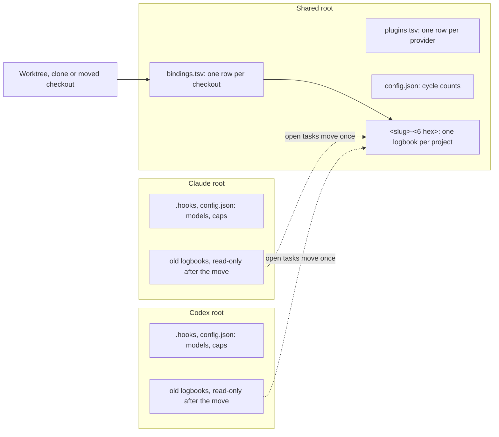
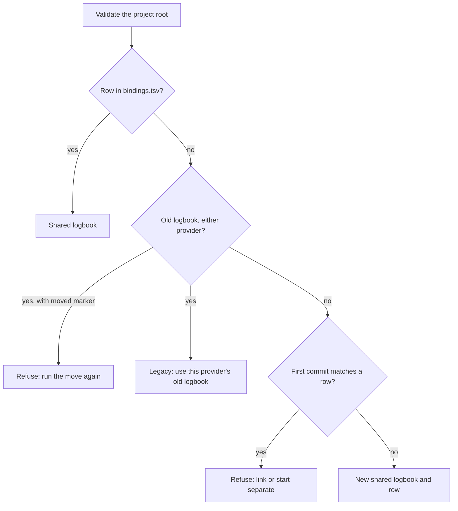

# T306 shared project logbook: design contract for owner approval

This page is the contract for one logbook per project, shared by Claude and Codex. It closes each finding of the PE review (R2023) and adds the move of existing projects.

- **Main point:** each project has one logbook in a new shared root. Each task has one owning chief. Any writer finishes a saved change first. Existing projects move by an explicit command: open tasks get new numbers, and finished tasks stay read-only in the old logbooks.
- **Where it fits:** the Codex design task T73 made the first sample and the owner decided its three gates. The PE review then found eleven gaps. This revision closes them. The next step is the owner's final approval, then PR 1 of the plan in "Build plan".
- **What I need:** approval of this contract and the sample, plus the answers to the four cases in "Cases that the task does not decide". This page grants no build approval.
- **Sample:** open `index.html` from this folder. It has no backend. Reload resets it. Every value is sample data. Its buttons simulate the chief's commands and the owner's answers; the real board stays read-only.

**Entry point (standing order 36):** the owner updates the sage plugin in Claude and in Codex. New projects then start shared with no action. For an existing project, the owner tells either chief to move it, and answers one gate.

**A note on task numbers.** "T74" in this page is the number in the Codex logbook. T74 in the Claude logbook is an unrelated docs task. This is the clash that F5 removes.

## The findings and where each one closes

| Finding | Decision | Section |
| --- | --- | --- |
| F1 (high) | A pending write is per project. Any writer recovers it as its first step under the lock, from the `owner` field saved in the intent. One project's pending write does not stop other projects' merges. | [Saved changes](#saved-changes-and-lost-replies-f1-f10) |
| F2 (high) | One resolution order. Cut-over is an explicit command after both plugins update. It writes a moved marker that both providers obey, and it needs zero running runs. | [Find the logbook](#find-the-logbook-f2-f3), [The move](#the-move-t74-f2-f5-f7) |
| F3 | Bindings live in a protected table in the shared root, keyed by the validated project root path. A move, a copy and a clone follow one rule: no row, refuse, explicit link. The folder name stays `<slug>-<6 hex>`. | [Find the logbook](#find-the-logbook-f2-f3) |
| F4 | Four writer classes, one guard point. The check prevents mistakes; it does not stop a hostile agent. | [Writer classes](#writer-classes-and-the-guard-f4) |
| F5 | Never import an old number. The new sequence starts above the highest number in both old logbooks, for T, R, G and P. A migrated task keeps its old branch through its adoption record. | [The move](#the-move-t74-f2-f5-f7) |
| F6 | One checkout for each binding. A branch resolves through the checkout that dispatched the run. | [Runs and reports](#runs-checkouts-and-reports-f6-f7) |
| F7 | Keep a late report for a run that ended as blocked or failed. It backs no verdict. The move copies no verdict or kept report, and a moved open task gets fresh reviews. | [Runs and reports](#runs-checkouts-and-reports-f6-f7), [The move](#the-move-t74-f2-f5-f7) |
| F8 | Provider model keys stay per provider. Cycle counts live in the shared root. Both hooks protect the new root. `.hooks` stay per provider. | [Config and hooks](#config-and-hooks-f8) |
| F9 | The board compares the folder before and after a read, retries, then shows a "changing" note. It reads hook notes from the provider roots and tables from the shared root. Runs get a provider column. | [The board](#the-board-f9) |
| F10 | Keep T and R numbers inside a logbook. Use the taskVersion hash as the expected revision. Drop durable refused receipts. | [Data](#data-f3-f8-f10), [Saved changes](#saved-changes-and-lost-replies-f1-f10) |
| F11 | A run ending does not advance a waiting transfer. This page says "owning chief" for a chief and "owner" only for the person. | [Commands](#commands-f11) |
| Dead chief | Neither provider has an end signal wired. A dead chief is "unknown" and uses Replace. V1 designs no reclaim evidence. | [Commands](#commands-f11) |

## Owner decisions (not reopened)

- Reclaim happens only after the exact owning chief conclusively ends and its runs and pending changes resolve. Silence, a finished turn or an ended child does not establish an end. Unknown activity retains ownership.
- A transfer waits for active runs to finish and for the recipient's acceptance. The owning chief stays while it waits.
- Linked worktrees share one project identity. Other clones explicitly join the same local logbook.
- There is no cross-machine sync.
- The move (T74) is part of v1. It moves open tasks only, with new numbers. Finished tasks stay read-only in the old logbooks, labelled on the board.

V1 effect of the first rule: the rule stays, but no signal can satisfy it yet. The Claude manifest wires `Stop` and `SubagentStop`, and the Codex manifest wires `SubagentStop`. Neither wires a session end. So normal reclaim never fires in v1, and the sample has no "chief ended" state. A later task may add it by wiring a verified end signal; this contract then needs one new row in the command table.

## Data (F3, F8, F10)

**The shared root.** The default is `~/.sage`. `SAGE_SHARED_HOME` overrides it. When `SAGE_HOME` is set (tests and scratch runs), the shared root is `<SAGE_HOME>/shared`, so that a scratch run never reaches the real root. The folder name `shared` does not match the logbook pattern, so a folder scan skips it.

| Record | Fields | Rules |
| --- | --- | --- |
| `bindings.tsv` | `root`, `folder`, `commits`, `at` | One row for each checkout. `root` is the key: the validated project root path (today's `projectRoot`, then `realpath`). `folder` is the logbook. `commits` lists the first commits of the checkout. Only the state tool writes it, under the root lock. |
| `plugins.tsv` | `provider`, `contract`, `at` | Each provider's state tool writes its own row at its first command. The move reads it. |
| Logbook folder | `<slug>-<6 hex>` | Today's name rule, computed once at creation and saved in the row. A checkout move never computes it again. A new folder name that is already in use refuses. |
| `chiefs.tsv` (in the logbook) | `id`, `provider`, `native`, `at` | `id` is `C<n>`, a number inside the logbook. `native` is the provider's session identity. A restart or resume with the same identity is the same chief. |
| `tasks.tsv` | adds `chief`, `offer` | `chief` is a `C<n>` or empty. `offer` is empty or holds `{id, from, to}`. |
| `runs.tsv` | adds `chief`, `provider`, `checkout` | The chief that dispatched the run, its provider, and its binding row. |
| `gates.tsv` | adds `kind` | Empty, `replace` or `move`. Only the state tool writes a kind. |
| `sequence.json` (in the logbook) | `T`, `R`, `G`, `P` | The floors from the move. `nextId` takes the larger of this floor and the highest number in the tables. A new project has no file. |
| `sources.tsv` (in the logbook) | `provider`, `path`, `at` | The old logbooks of this project. The board reads it. |
| `moved.json` (in an old logbook) | `folder`, `at` | The moved marker. |
| `adoption` cell | version 2 | Today's record, with `pr` and `branch` optional. It holds the old provider, task, logbook, branch and PR. |

**Removed by F10.** The T73 draft had project, task and run UUIDs, a monotonic record revision and durable refused receipts. All are gone:

- A task is `T<n>` and a run is `R<n>`, inside one logbook. The logbook is the scope, so no second identity is needed.
- The expected revision is today's `taskVersion`: a hash of the task row. The row now holds `chief` and `offer`, so a claim, offer, cancel or accept changes the hash.
- An ownership generation is also gone, because the hash covers it. If a row returns to exactly the same text, a write that expected that text is safe.
- The offer keeps its short `id`, so that each new offer differs even for the same recipient.

## Find the logbook (F2, F3)

Every command resolves again; no command saves the answer. The order is one list, and the same code runs in both providers.

1. **A binding means shared.**
2. **No binding plus a legacy logbook means legacy.** "Legacy" checks both provider roots, because the folder name is the same under each. Without this, a Claude chief in a Codex-only project would make a new shared logbook and hide the Codex tasks.
3. **Neither means new shared,** with one guard below.

**Why the guard.** F2 says "neither means new shared", and F3 says a moved checkout with no row must refuse. A moved checkout has no row and no legacy logbook, so the two rules collide. The guard separates them: the checkout's first commit (`git rev-list --max-parents=0 HEAD`) is compared with `commits` in every row. A match refuses and offers the link. No match is a new project. This runs only when no row exists, so it costs nothing on a normal command. It makes no change in the project, and it treats a move, a copy, a clone and a fork the same way.

The first commit never joins two logbooks. It only stops a silent new logbook. The join needs an explicit link. This keeps the earlier rule that a matching remote, path or number never establishes identity.

**Linked worktrees** resolve to their main checkout through `projectRoot`, so they use its row and need no row of their own.

**The explicit link.** `sage link --to <folder>` adds a row for this checkout. `sage link --separate` adds a row with a new folder. The chief runs either one only after the owner's answer in the chat. Each command checks the folder under the root lock. A row whose path no longer exists stays until the owner removes it, and it does no harm.

| Situation | Result |
| --- | --- |
| Row names a folder that is missing, or a folder of another project | Refuse reads that claim to be current, and all writes. Offer the link. |
| Two rows for one path | The key is unique; the state tool refuses a damaged table. |
| Repository with no commits, or a folder that is not a Git repository | No first commit, so no guard. A moved folder of this kind starts a new logbook. This is a documented limit. |
| Binding table is unreadable | Refuse. Never fall through to rule 2 or rule 3. |

## Every writer uses one operation

`withLogbook(project, actor, class, fn)` is the one entry for every writer: the CLI, the Codex MCP tools, report acceptance, readiness changes and stop hooks.

1. Resolve the logbook.
2. Take its lock.
3. Recover a saved change, if one exists.
4. Run today's integrity check.
5. Run the guard for the writer class.
6. Run the command.

## Writer classes and the guard (F4)

| Class | Commands | Who may write |
| --- | --- | --- |
| Task writes | `task set`, `round`, `run add`, `finding`, `verdict`, `task-adopt`, offer, cancel, release, `log` on a task | The owning chief of that task. `task add` and `program propose` assign the new tasks to the chief who adds them. An unclaimed task takes `claim`. |
| Any chief | Open a Replace gate. Writes with no task: `standing`, `config`, `log` with no task | Any chief of the project, as today. |
| Gate answers | `gate answer` | The owner's own words, from either provider, by today's rule. The hook of the session that holds the owner's message checks them. |
| Stop hooks | Keep a report, end a run | The hook writes only the run of its own slot. It needs no owning chief, so a transfer or Replace cannot lose a report. |

The guard is one function in core, called from step 5. No command has its own ownership check.

**How the tool knows the actor.** The Codex MCP tools already read the native root identity. The Claude CLI has no such input, so each chief command carries `--chief C<n>`. The Claude hook knows the session and refuses a value that does not match this session's row. Children never run chief commands, as today.

**Limit.** The check prevents mistakes by normal agents. It does not stop a hostile agent, which can give another chief's id. This follows standing order 49.

## Commands (F11)

| Command | Conditions | Change |
| --- | --- | --- |
| Claim | Unclaimed; expected version is current | Set `chief`. |
| Offer | Owning chief; no open offer | Set `offer` to one other chief. The owning chief stays. Active runs may continue. |
| Cancel | Owning chief; exact open offer | Clear `offer`. Active runs do not stop it. |
| Accept | Named recipient; exact open offer; expected version is current; no active or unknown run of the task | Set `chief` to the recipient and clear `offer` in one write. |
| Release | Owning chief; no open offer; no active or unknown run | Clear `chief`. Work and reports stay. |
| Replace | A `replace` gate that names the owning chief and the new chief; the owner's answer | One write: set `chief`, clear `offer`, end each active or unknown run of the task as failed. |
| Task change | Task write guard; expected version is current | Change the permitted fields. Existing checks stay. |

- **A run ending does not advance a waiting transfer.** The run's row changes, but the task row does not, so the task version stays. The recipient still must accept. The board shows that the transfer is ready.
- **A cancelled offer never becomes valid.** Example: `OFFER-1`, cancel, then `OFFER-2` to the same chief. Acceptance of `OFFER-1` refuses and changes nothing. Acceptance of `OFFER-2` succeeds.
- **A dead chief is "unknown".** Any chief opens a Replace gate; the owner answers. The gate names each run that will end as failed. An ordinary restart or resume keeps the same chief, with no gate.
- **A replaced chief** gets a refusal that names the new owning chief.

## Saved changes and lost replies (F1, F10)

The saved change is today's marker, `review-pending.json`. There is one marker for each logbook, so the marker is already per project. Two things made it behave as a wider block, and this contract changes both.

**1. Recovery needs the caller's own request.** Today `recover` refuses unless the caller gives the same reference, and a task update refuses a different `owner` field (`old-owner`). A different writer can only stop. New rule: step 3 reads the saved intent and recovers it from the `reference` saved in it, with its `owner` field. Then the writer continues with its own command. Recovery gives the writer no authority on the task.

**2. The merge check scans every folder.** `assessMerge` runs `check` on each logbook in the root, and `check` throws on any marker. So one project's marker refuses all merges. New rule: the merge check recovers its own project's marker, and it skips another folder that holds a marker, with a note.

| Case | Result |
| --- | --- |
| Saved change, its chief is gone | The next writer of the project finishes it. No claim or gate is needed. |
| Saved change cannot finish (damaged, or a table has neither its before nor its after text) | Writes and merges of this project stop, with the request named. The owner repairs it. Sage never drops it. Other projects continue. |
| A read-only board check | Shows the marker. It never recovers. |

**A coordinated write needs a change.** A Codex task update (`coordinatedWrites`) decides through a callback into the Codex admission journal, so a Claude writer cannot finish it today. PR 2 adds a rule that needs no provider. The prepare step writes the marker before any table changes, so:

- If the saved intent holds no recorded decision, recovery restores the "before" tables and removes the marker. The request reads as not found, and a retry is safe.
- If it holds a decision, recovery completes it.
- So the decision moves from the journal into the logbook folder, beside the marker. Codex keeps its own fence and releases it at its next turn.

This is the largest engineering item in the contract. The PE should check it first.

**Reading a request after a lost reply.** The read takes the lock, so it runs recovery first. Three results remain:

| Result | Meaning | Next action |
| --- | --- | --- |
| committed | A receipt holds the result. | Return it. Do not repeat the command. |
| not found | No receipt and no saved change. The command did not happen, or sage refused it. | Retry the same request with the same payload. It checks the task again. |
| cannot finish | The saved change is damaged. | The project stops; see the table above. |

A refused command writes nothing, so a lost refusal reads as "not found", and the retry gets a fresh answer. A retry with a different payload refuses. A read failure is never "not found".

## Runs, checkouts and reports (F6, F7)

- **One checkout for each binding.** `checkout.txt` held one path for a logbook. Two linked clones need more, so `bindings.tsv` replaces it. The move writes the rows from each old `checkout.txt`.
- **A branch resolves through the checkout that dispatched the run.** A run saves its binding in `checkout`. `reviewHead` and the merge check use that checkout, because a branch of one clone may not exist in another. If that path is gone, the check refuses and names the run. The merge check does not try another clone.
- **A late report stays.** Today `keepReport` refuses a run that already ended. New rule: a run that ended as blocked or failed keeps its late report, once, with its arrival time. The verdict rule (a run that ended done, on the commit of the verdict) stays, so a late report backs no verdict. The owning chief can read it.
- **A transfer changes no run.** The run keeps the chief that dispatched it.

## Config and hooks (F8)

| Item | Home | Reason |
| --- | --- | --- |
| `model.*`, `arena_models` | Provider root | Model names differ by provider. |
| `max_agents`, `cap_total`, `cap.<project>` | Provider root | Each hook counts its own agents. |
| `.hooks` (slots, helpers, session notes) | Provider root | Hook state belongs to one running provider. |
| `cycles.small`, `cycles.large`, `cycles.risk`, `max_rounds` | Shared root | One project must need the same clean cycles from either chief. |
| Project `name`, `archived` | The logbook's `config.json` | As today. |

`config()` reads each key from its home for a shared project. A legacy project keeps reading the provider root. An invalid cycle count still refuses every merge. At the first shared write the shared root takes the larger of the two provider values for each count, so a project never needs fewer cycles than the owner wrote. The owner's floors stay.

**Both hooks protect the new root.** The Claude hook adds it to the protected paths and adds `SAGE_SHARED_HOME` to `ROOT_VAR`. The Codex hook adds the same to its own check. `protected-paths.mjs` already takes a list of roots. Both protect `bindings.tsv`, `plugins.tsv` and each logbook's new files, through `LOGBOOK_FILES`.

## The board (F9)

- **Consistent reads.** Readers take no lock. The board records the folder's receipts and each table's size and change time before a read, and compares them after. On a difference it retries twice. Then it shows the last read with the note "The logbook is changing".
- **Where it reads.** Tables come from the shared root. Hook notes come from each provider root (`readHookNotes`). `standardSources` adds the shared root. A logbook's hash for its lead slots uses the shared folder path.
- **Provider column.** Each run row shows its provider, from the new `provider` column.
- **Old logbooks.** `sources.tsv` joins each old logbook to the project view. Finished tasks show with the label "Old · Claude · read-only" or "Old · Codex · read-only". A legacy project that has not moved shows as it does today.
- **Ownership.** Each task row shows its owning chief, an open offer, or "Unclaimed". "Needs you" marks a task with an unknown chief or an open Replace gate.

## The move (T74) (F2, F5, F7)

The move is the cut-over: one explicit command, `sage logbook move`, with one owner gate. It runs after PR 4.

**Preconditions.** Any failure refuses, and the old logbooks stay as they are:

1. `plugins.tsv` shows both providers at the shared contract.
2. Zero running runs in both old logbooks.
3. No saved change in either old logbook, after recovery.
4. Every open task's waits resolve. A wait on an abandoned task refuses, and the preview names it.

**Steps.** Each step is safe to run again:

1. The chief runs the preview and opens a `move` gate with the plan.
2. The owner answers. The owner's answer starts the command.
3. Take the root lock, then both old logbook locks in path order.
4. Save the plan in `moves/<folder>.json`.
5. Make the logbook, `sequence.json`, `sources.tsv` and the new rows of tasks.
6. Write `moved.json` in each old logbook, and add the `moved` column to its `tasks.tsv` header.
7. Write the `bindings.tsv` rows last.
8. Remove the plan.

If the command stops after step 6, the old logbooks refuse writes and name the fix: run the move again. A project is never writable in two places.

**The moved marker holds both ways.** A new plugin obeys `moved.json` through the resolution order. An old plugin obeys the column: today's `ready` refuses a table with an unknown column and tells the user to update. Reads, status and the merge check still work.

**What moves and what stays.**

| Item | Result |
| --- | --- |
| Open task (not merged, concluded or abandoned) | Moves with a new number and starts unclaimed. Priority, kind, size, risk, route and round stay. A `verifying`, `verified` or `pr-ready` task returns to `reviewing`. |
| Branch and PR | Stay on the old names, through the adoption record. `mayName` already reads it. Its `cycles` keeps the source minimum. |
| Finished task | Stays in its old logbook, read-only, labelled on the board. |
| Verdict, ledger row, kept report | Never move. The moved task gets fresh reviews and QA. |
| Run | Never moves. No run is active at the move. The moved task's history links to the old logbook. |
| Open finding of an open task | Moves with a new key. Its summary names the old key. See question 1. |
| Unanswered gate of an open task | Moves with a new G number. |
| Program with an open task | Moves with a new P number. Its breakdown gate moves with its answer. A wait on a finished task counts as met, and a decision row records it. |
| Task that another task adopted | Only the adopting task moves. The adoption record is the explicit link. |
| Two open tasks with one branch and no adoption | Both move as separate tasks. The preview warns. No guess joins them. |

**Numbers (F5).** `nextId` runs on each old logbook. Each floor is the highest number of the two logbooks, for T, R, G and P separately. The moved tasks take the first new numbers, Claude's first, each group in old-number order. An old number is never used in the new logbook, so a report that says "T74" can point to only one record in that logbook.

**Not in scope.** No finished task moves. No cross-machine sync. No automatic move. The old logbooks stay on disk; deleting them is the owner's own choice.

## Build plan

This plan keeps step with the PE plan. Each PR leaves existing projects working.

| PR | Scope | Closes |
| --- | --- | --- |
| 1 | Shared root, `bindings.tsv`, resolution order, link commands, config split, hook protection | F2 (order), F3, F8 |
| 2 | Provider-neutral recovery, merge check per project, the coordinated write change | F1, F10 (receipts) |
| 3 | `chiefs.tsv`, `chief` column, the guard and its classes, `task add` claims | F4, F10 (fields) |
| 4 | Offer, cancel, accept, release, Replace gate, late reports | F7 (reports), F11, dead chief |
| 5 | Board: shared reads, "changing" note, provider column, old labels, run `checkout` | F6, F9 |
| 6 | Clone link: linked clones in the board and the branch rule | F3 (clones), F6 |
| T74 | `sage logbook move`, moved marker, sequence floors, adoption version 2 | F2 (cut-over), F5, F7 (move) |

## Sample states

Each state is one entry in the "Sample state" menu, at phone and desktop width.

| Group | States |
| --- | --- |
| Ownership | Ready, success, competing claim, transfer offered, transfer with a run active, owning chief unknown (Replace), late report kept |
| Saved changes | Next writer finishes it, cannot finish, reply lost |
| Project link | Moved, copied or cloned checkout (link or separate); link conflicts |
| Move | Preview, must wait, stopped part way, done |
| Reading | Empty, loading, read failure, logbook is changing, correction |

Changes from the T73 sample:

- "Quiet" and "exact chief ended" are gone. V1 has one state: unknown.
- Replace is now two steps: any chief opens a gate, then the owner answers.
- The saved change no longer blocks. The next writer finishes it.
- The request has three results, not four.
- Record revision, generation and UUID aliases are gone. The sample shows the task version.
- Runs show a provider column.

The sample cannot prove races, durable writes, provider lifecycle or crash recovery.

## Alternatives rejected

| Alternative | Why not |
| --- | --- |
| Lease expiry for a chief | Silence does not establish an end, and the owner chose explicit recovery. |
| Immediate reassignment | The owner chose recipient acceptance and finished runs. |
| One writable copy for each clone | It makes several task records. |
| Import old numbers with a prefix (`C-T12`) | F5 forbids it. Two number forms would touch every id rule. |
| Move finished tasks too | The owner chose open tasks only. It would also move years of verdicts that the merge check no longer needs. |
| Checkout evidence: a stamp file in `.git` | It works without a remote, but it adds a file in the owner's repository, and a clone does not carry it. |
| Checkout evidence: match the remote URL | It fails for a repository with no remote and for a changed remote. The first commit needs neither. |
| Checkout evidence: none | A moved checkout then starts a new empty logbook in silence. |
| A new recovery screen | Contextual actions on the task add no steps. |
| Moved marker only in the shared root | An old plugin never reads it. The header column uses a refusal that old plugins already have. |

## Cases that the task does not decide

1. **Open findings at the move.** The brief names verdicts and kept reports only. Options: move open findings with new keys, or drop them. Recommendation: move them. A known problem must not disappear because a task changed number.
2. **Owning chief of a moved task.** Options: unclaimed, or the chief that runs the move. Recommendation: unclaimed. The chief that runs the move may have no context on another provider's task.
3. **A fork with the same first commit.** Options: refuse and offer link or separate (one extra question), or always start new. Recommendation: refuse and offer both. A fork is rare, and a silent new logbook for a moved checkout costs more.
4. **A provider that the owner does not use.** The move needs both plugins updated. Options: always require both, or let the owner confirm that a provider is not installed. Recommendation: let the owner confirm in the move gate, and record it. The refusal for a later old plugin still holds.

## Not verified

- No backend exists. Nothing in this page was run against a real logbook.
- `git rev-list --max-parents=0 HEAD` speed on a large repository, and the fork case.
- A Claude resume keeping one session identity. If it changes, the chief reads as a new chief and the owner uses Replace. PR 3 must test this.
- A Codex chief or MCP server writing to the shared root and to the Claude root under the Codex sandbox. The move writes to both old roots. PE should check this first for T74.
- The cost of this work. There is no measured basis for a range. The PE plan has six PRs and the move.

Skills applied: experience-first, exhaust-the-design-space, contextualize-and-write-for-the-reader, writing-standard, dictionary.
