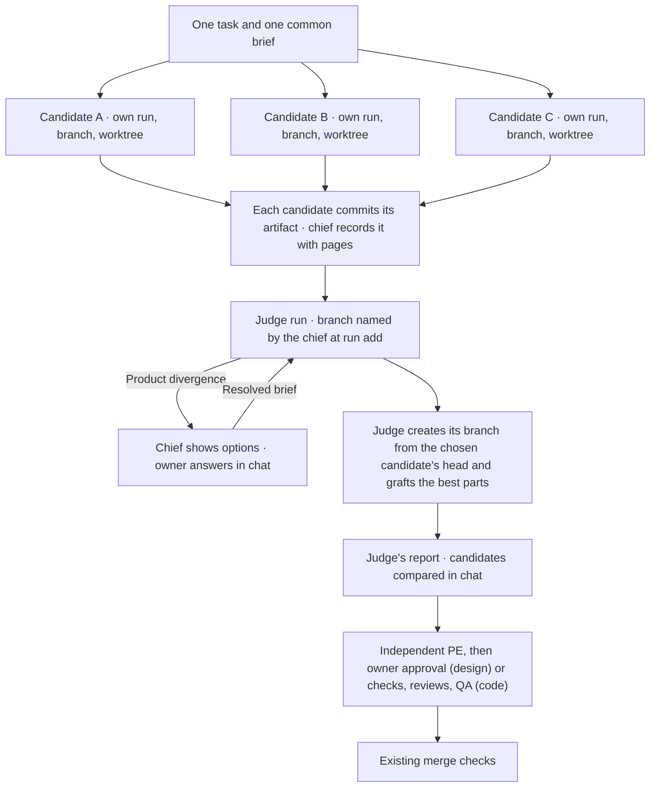

# T583 arena design for Codex

This is the corrected design for an arena on Codex. It replaces the T92 design. It is a design only: no code changes, and the owner has not approved it.

The clickable sample is `index.html` beside this file. Open it from disk. Every task, report, score and branch in it is fictional sample data.

## For the owner

An arena gives one task to several candidates. Each candidate works on its own branch. A judge then scores them, picks the best, and grafts the best parts of the others onto a separate branch.

What you decide: the three points under "Decisions" below. The chief took them under your "best judgement" note. Answer only if one is wrong.

What this costs:

| Item | Estimate | Basis |
| --- | --- | --- |
| Agent time | About 8 to 16 hours | Weak basis: the sizes of the diffs (see "Plan") |
| Your time | About 30 to 60 minutes | Approve this design, merge 3 pull requests, run the installed pilot |

What you do next:

1. Open `index.html` and look at the 3 screens and 6 situations.
2. Tell the chief to proceed, or name the decision you want to change.

## Decisions

The chief took these three. Each has a reason and a way back.

| # | Decision | Reason |
| --- | --- | --- |
| 1 | Candidates are compared in the chat and in the judge's report. There are no board views for now. | The board stays a reader. A board view adds a screen and a write path for little gain. Later work can add it. |
| 2 | Branches and pages stay until you delete them. Worktrees go at the end of the task. | Branches and pages are the evidence. Worktrees are only a place to work. |
| 3 | The separate judge branch applies to both providers (Claude and Codex). | One rule is simpler than two. The Claude flow changes too (see "Plan", PR 1). |

## The arena flow

The arrows show the required order. They do not start agents by themselves.

Steps in short:

1. The chief records one task, the criteria (3 to 6) and the candidate runs. Each candidate run has its own branch.
2. Each candidate does the work and commits its artifact on its own branch. The chief then records the artifact with `pages`.
3. The chief adds the judge run and names its branch at `run add`.
4. The judge creates that branch from the chosen candidate's head. If the branch exists, the judge refuses and stops.
5. The judge grafts the best parts of the other candidates onto its branch and writes the report.

## Rules

| Case | Required behavior |
| --- | --- |
| Capacity | "At most three" limits the candidates that run at the same time. An `arena 4` runs in waves: three first, then the fourth when a slot is free. The current host and project limits also apply. This design states no host number. |
| Candidate artifact | Each candidate commits its artifact. The chief then records it with `pages`. An artifact that is not committed does not count. |
| Judge branch | The chief names the judge's branch at `run add`. The judge creates it from the chosen candidate's head. The judge refuses if the branch exists. The judge branch differs from every candidate branch. |
| Branch overlap | The state tool refuses two writers on one branch, in both admission orders. This includes a judge against a candidate and a judge against a judge. |
| Merge check | The merge check refuses a candidate head. Only the judge's branch can merge. **This does not exist today. It is work for PR 1.** |
| Candidate ends blocked | Keep the report, branch, head and partial files. The chief decides if the usable evidence meets the brief. No silent success. |
| No artifact | Keep the candidate's row and reason. Show no score (a dash, never a zero). If the other candidates are enough, the judge scores them and says what is missing. |
| No usable candidate | No winner and no result. The chief resolves the brief. |
| Divergence | If the candidates disagree on the product, the judge reports both choices with a recommendation. The chief asks the owner. The judge does not average them. |
| Correction | Keep old runs and reports. A new run gets a new id and its own branch. |
| Retention | Branches and pages stay until the owner deletes them. Worktrees go at the end of the task. |
| After the judge | A design goes to the PE, then to the owner for approval, then to the build. Code goes to the checks, the reviews and QA. A score never replaces a review. |

### Scores

- The scale is 1 (misses), 2 (partly meets), 3 (meets with a limit), 4 (meets clearly).
- A criterion that was not assessed shows a dash, never a zero.
- The sample shows no total. Scores explain a choice. They do not replace judgment.
- For close candidates, the judge prefers the smaller coherent result.

## Plan

Three pull requests, then a pilot. Each pull request is a separate task with its own review.

| Step | Size | What it changes |
| --- | --- | --- |
| PR 1: shared rules | Large | `state.mjs`: the judge run needs `--branch`. The state tool refuses branch overlap in both orders. The judge branch must differ from each candidate run's branch. The merge check refuses a candidate head. Also the role texts and the Claude texts, because the Claude arena flow changes too. |
| PR 2: Codex retention | Small | The report gate keeps the implementer and judge reports. It reads a candidate's SHA from its run's branch. |
| PR 3: Codex enablement | Not sized yet | The Codex bindings and references. |
| Installed pilot | Not a pull request | One real arena on Codex, run by the chief after the three pull requests merge. |

PR 2 and PR 3 wait for PR 1.

Cost:

- Agent time: about 8 to 16 hours across the three pull requests and the reviews.
- Basis: weak. It comes from the sizes of the diffs and past tasks of similar size, not from a measurement.
- Your time: about 30 to 60 minutes (approve this design, merge 3 pull requests, review the pilot).

## Sample behavior

The sample is in `index.html`. A selector shows each situation directly. It is a design control, not a production state change.

| Situation | Meaning | Allowed sample step |
| --- | --- | --- |
| Empty | No candidate evidence | Show sample runs, then Loading |
| Loading | A and B run; C waits (capacity) | Finish sample runs, then Success |
| Failure | B's end is uncertain and its report is missing; C failed | Read the kept evidence; nothing advances |
| Correction | A's branch moved; B's report digest does not match | Show separate corrected runs, then Success |
| Success | Two artifacts; one empty, failed candidate | Proposal, then the next review; no approval occurs |
| Divergence | List first against search first | Preview a fictional owner choice |

The sample has 3 screens: compare candidates, the proposed result, and the next review. It has no timers, downloads, network calls or saved state. Reload or Reset sample restores the start.

## Alternatives considered

- **A board view for the comparison.** Rejected for now (decision 1). It needs a new screen and adds navigation.
- **An editable score and approval dashboard.** Rejected. It gives the board a write path.
- **A judge that edits the chosen candidate's branch.** Rejected. It changes the candidate's evidence. The separate judge branch keeps every candidate unchanged.
- **The judge branch created before the judge starts, by the chief.** Rejected. The chief changes no files. The chief only names the branch, and the judge creates it.
- **A fixed host limit in this design.** Rejected. The limit has no source in the code, so the design says the current limits apply.

## Not decided here

These cases stay open, and none of them blocks PR 1:

- The default number of candidates when the owner does not say (the config default is 3 today).
- Whether a repeat arena on the same task reuses candidate branch names. The design assumes a new run gets a new branch.

## Verification of this design

- The sample was opened from a file URL in a headless browser at 375 and 1280 pixels. The report of the run lists the result.
- No server ran. No Codex command ran.
- Claim 3 above was checked in `packages/sage-core/state.mjs` on main: it has no check that refuses a candidate head. The merge check is work for PR 1.
