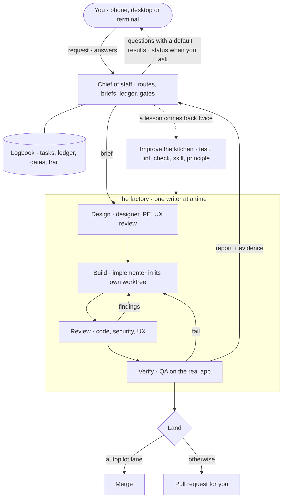
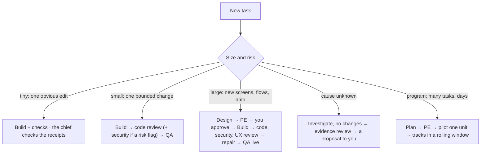
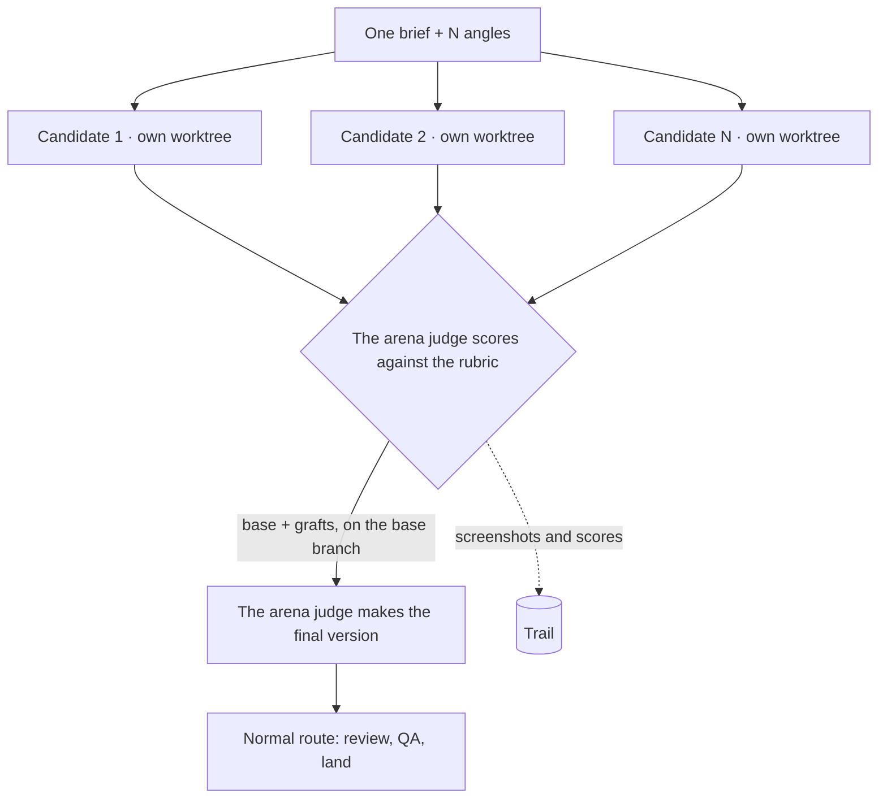
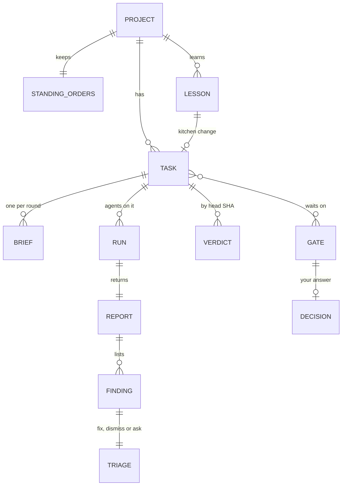
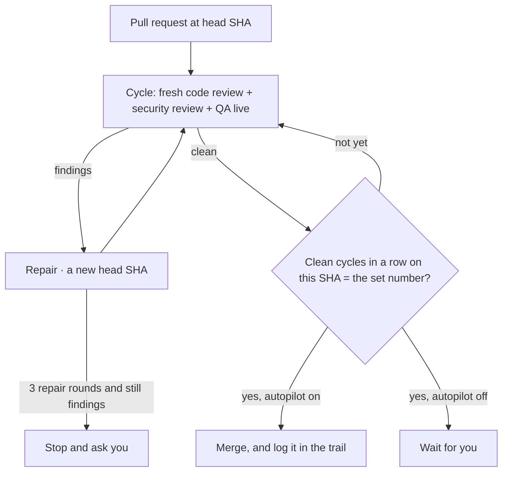

# Sage mode

> **A dated design.** This is the design of sage mode as it was approved on 4 Oct 2026, before the build. It was converted from an HTML page, with its words as they were. sage changed after it: the [README](../../README.md) says what sage does now, [Rules held in code](rules-in-code.md) lists the rules that the code holds today, and the [changelog](../../CHANGELOG.md) lists each change. "I" in this page is the author, and "you" is the owner.

Design v3 · the sage plugin · 4 Oct 2026 · status: **the kitchen and the team are built; dry run 1 is done; the pilot is next**

**What this is.** The design of sage mode: you say "sage mode", and the session becomes your chief of staff. The chief of staff runs a factory of specialist agents, like Orchestrator, but inside any Claude Code session, from your phone or your desktop. There is no app and no dashboard: the chat is the interface, and the state is plain files.

**Main point.** Use one chief that never writes code, with specialists that write one at a time. Code enforces the important rules: hooks, plus one small state tool. Each task gets a route made from building blocks, sized to the task, instead of a fixed flow.

**New in v2.** Your decisions ([section 15](#decide)), autopilot as "everything merges through a pull request after a set number of cycles", the [arena](#arena) block, and a [sample session](#prototype) that shows the experience.

**What I need from you.** Two details and your go to build, in [the last section](#decide).

<a id="fit"></a>

## 1. Where it fits

- **The goal.** Make this your default way to design and build. You say what you want, answer the few product questions, and look at results: screens, recordings, test results. You don't read code.

- **What came before.**

  - *agent-kit* gave every session its principles, the writing standard and the prove-it-works stop check. It is now the same plugin as sage mode, named sage: the kitchen and the orchestration layer in one place, with pstack's principles followed by a weekly sync.

  - *Orchestrator* proved the factory ideas: a PE, reviews running side by side, no dropped findings. It's a heavy app with fixed flows.

  - *The Remote Control server* in `~/workspace` lets you start sessions from your phone.

  - *A first prototype* showed that a folder setting can start a session as the chief of staff.

- **What comes next.** You decide the five questions. Then I build it in small checked steps ([the plan](#plan)), with a pilot task first.

<a id="loop"></a>

## 2. The loop

There are two loops. The inner loop turns a request into verified work. The outer loop improves the kitchen, so the inner loop gets better over time.



The chief of staff never edits files. It writes briefs, records verdicts and asks you only product questions and irreversible actions.

<a id="sources"></a>

## 3. What we take from each source

| Idea | From | In sage mode |
| --- | --- | --- |
| A chief that owns the program, never the code | pstack orchestrate, Cursor projects | While sage mode is on, the hook refuses the chief's file edits. After the off phrase, the session edits files as a normal session. |
| "The brief is the product." A missing field stops the spawn | pstack orchestrate | A brief template with required fields. The hook refuses an agent spawn when a field is missing. |
| Verdicts recorded by head SHA. A new commit voids them | pstack ledger, Orchestrator "merge the exact checked commit" | A ledger in the logbook. A merge is blocked unless the current SHA has the verdicts its route needs. |
| A mode switched on by name, with playbooks copied into the to-do list | poteto mode | "sage mode" as the whole message. Each route's blocks go into the task list. |
| Scale the ceremony to the unit | pstack, Anthropic research system | Routes come in sizes: tiny, small, large, program. |
| A PE that separates "changes" from "questions for you" | Orchestrator, after the PE loop failed to converge | The same verdict shape. A later PE pass checks its earlier asks first. |
| Code review and security review side by side. No dropped findings | Orchestrator ORC-021 and ORC-028 | Each finding gets a triage: fix, dismiss with a reason, or ask you. A task can't finish with an open finding. |
| One writer. Reviewers in a fresh context | Cognition 2026, Claude Code docs | Only the implementer and the designer write, each in their own worktree. |
| Rules as prompts decay. Encode them in structure | Orchestrator lessons, poteto's trust ladder | The important rules are code: hooks and the state tool ([rules](#rules)). |
| Completions are queue events. Never review inline | pstack orchestrate | The chief records a report and starts a reviewer. It doesn't read the diff itself. |
| A pilot before fan-out | pstack orchestrate | A program-sized route runs one unit end to end first. |
| Build verification first | poteto, Anthropic harness posts | QA needs a live run of the real app for behaviour changes, not only tests. |

<a id="team"></a>

## 4. The team

| Agent | Does | Writes? | Principles it loads |
| --- | --- | --- | --- |
| **chief-of-staff** | Frames the work, picks routes, writes briefs, drains reports, triages findings, keeps the ledger, asks you the questions | No: the state tool only | never-block-on-the-human, encode-lessons-in-structure, contextualize-and-write-for-the-reader |
| **designer** | A clickable prototype with sample data, 2–3 options when the answer isn't clear, every state | Design files, own worktree | experience-first, exhaust-the-design-space, writing-standard |
| **pe** | Checks feasibility, data, risks and cost before the build. Verdict: OK, CHANGE or QUESTION | No | foundational-thinking, boundary-discipline, laziness-protocol |
| **implementer** | Builds one task, runs the checks, opens the pull request, repairs findings | Code, own worktree | laziness, subtract-before-you-add, test-behaviour, prove-it-works, fix-root-causes |
| **code-reviewer** | Correctness, data safety, regressions, test evidence | No | test-behaviour, minimize-reader-load, migrate-callers |
| **security-reviewer** | Input at the boundaries, injection, secrets, access, dependencies | No | boundary-discipline |
| **ux-reviewer** | The flow, the states, the copy and accessibility, against the design | No | experience-first |
| **qa** | Runs the checks and the real app, tries to break it. Verdict: PASS or FAIL with evidence | No | prove-it-works, test-behaviour |
| **arena-judge** | Scores an arena's candidates against the rubric, picks the base, grafts the best parts of the others into it, and checks the result (Opus) | The base branch | exhaust-the-design-space, experience-first, laziness, prove-it-works |
| **lead** | Runs one task's pull request from the build to its clean cycles: briefs the implementer, runs the reviews and QA in cycles and the repair rounds, records its own task's runs, findings and verdicts, and reports once to the chief | No: the state tool, on its own task only | never-block-on-the-human, prove-it-works |

<a id="lead-loop"></a>

### One lead for each pull request

The chief keeps the framing, the design, the PE check, your questions, the checks verdict, the move to verified and the merge. For the rest of a task with a build, it starts one lead, and waits for its one report. It starts no other agent for that task while its lead runs.

1. **The chief** moves the task to briefed, records a lead run (`sage run add <T> --role lead`; a held task moves first, because its move to briefed ends a running lead run), and starts `sage:lead` from the project's folder, in the background, with the name `lead-T<n>` and a full brief. The name is the Agent tool's `name`, or the first word of its `description` when the tool has no `name` field, as in the desktop app. The brief gives the state tool's path, the branch, the pages folder and the count of clean cycles: 1 (autopilot off) or the task's count (autopilot on). The hook refuses a lead with another name, with `run_in_background` false, or for a task with no running lead run. The lead and each helper take a slot of the project's agent cap (`max_agents`, 4 by default), so with the default cap one lead runs at a time.

2. **For each helper**, the lead runs `run add <T> --role <role>`; the hook sees its printed line, and the run is the lead's. The lead starts the helper with the run id `R<n>` as its name (the `name`, or the first word of the `description`), in the background, with a full brief. At the helper's stop, the hook keeps its RESULT, the severity of each finding and the commit that it saw. The lead records each finding with `finding add` (a one-word `--summary`), then `run done`, then the verdict with `--run` and `--pr`. A medium or high finding goes to a repair round. A low one is dismissed with a reason, joins a round, or ends the lead blocked for the chief to move. At most 3 helpers run at once; a large task's fourth role starts after one of them stops. The hook refuses a lead's TaskStop, and any agent's TaskStop of an agent: only the chief stops an agent.

3. **The cycles and rounds** go as the chief's did: a findings verdict, a fix triage, `round`, a fresh implementer, a re-check of the roles that `round` named, `finding close`, back to reviewing, then the clean cycles on the final SHA. A tiny task has no review or QA. The lead moves the task one cycle step at a time, and never from held. It runs `gh pr checks <n>` and moves the task to verifying; the checks verdict is the chief's.

4. **The lead ends** with one report in the seven fields. The chief records the lead's run and checks it against the logbook. After a ready report, it records checks-pass after `gh pr checks`, moves the task to verified, and merges (autopilot on) or tells you that the pull request is ready. A lead that cannot clear a finding itself (a low one with no round, a new one from a re-check, or a fix that the re-check does not confirm) ends blocked. So does a lead in any state, or after any answer, that its file does not name: it does not work around it. The chief takes no state from the report. It reads the task's rows in the logbook and decides, and its only state moves from the logbook are repairing to reviewing (a fix that the re-check did not confirm gets the next round, or a replan) and reviewing to verifying (the checks passed). It may move a low or new finding to a follow-up task; the state tool refuses a move of a high finding, and of a fix key of the round until you answer a gate that names it. The chief never dismisses a finding because the lead calls it a repeat of a fix: it triages it fix, so that it joins the next round. An unconfirmed low fix joins the next round while a medium or high finding is open; otherwise the chief frames a follow-up task, then dismisses the key with the reason that the follow-up carries it. After a ready report whose head moved, the chief records no verdict and brings GitHub's head into the local branch (a fast-forward, or a gate when it is none), and the fresh lead moves the task from verifying back to reviewing. Then the chief starts a fresh lead, which goes on from the logbook. After a CI failure, the chief adds a finding with the source qa and triages it fix, so QA re-checks the repair. After your answer, or a lead that stopped with no report, a fresh lead goes on from the logbook.

The lead's file (`agents/lead.md`) ends with two examples: one lead's life, and a lead that ends blocked and a fresh lead after it. The test `scripts/lead-agent.test.mjs` plays each of their lines through the hook, from the start of `lead-T1` to a passing merge check after the chief's steps. It runs their git, gh and logbook reads, compares each printed line with its own command's output, and checks that the examples run every command form that the file teaches. It also plays the file's state table, verdict table and helper cap against the hook. So the file teaches only what the hook allows.

Each agent is a file in `plugins/sage/agents/`. Each loads the plugin's own principle skills that its role needs. An agent that doesn't change outcomes gets cut after the pilot. Anthropic's harness post found that each role encodes a guess about what the model can't do alone.

<a id="routes"></a>

## 5. Building blocks and routes

This is where sage mode is more flexible than Orchestrator. Orchestrator has six fixed flows, and changing a task's flow starts it over. In sage mode, the chief of staff builds a route for each task from blocks. A route has a minimum for each size and risk, and checks in code enforce that minimum.



Risk flags: auth, personal data, a schema or migration, money, secrets, input from outside. Any flag adds the security review to every size except investigate, which changes no code.

### The blocks

Frame · Design · Arena · PE check · Build · Code review · Security review · UX review · QA · Repair · Land · Learn

### The chief may add

Any block, with a one-line reason in the trail. For example: a PE check on a small task that touches a migration.

### The chief may not remove

The minimum of the size and the risk flags. The merge check blocks the merge when a required verdict is missing.

### Design: your default way to design

The Design block is Orchestrator's Vision, made smaller. It works in rounds, one focus at a time: the experience, the data, the flows. The designer makes a prototype you can click, with sample data. The PE checks it. You mark each part keep, change or drop, as a choice with previews. The parts you keep go into the decision log. Implementers then build against it, and QA checks against it.

<a id="arena"></a>

### Arena: N candidates, a judge takes the best of each

For a design with no clear answer, or for an implementation that's hard to undo, the chief can run an arena. It follows pstack's arena, within Claude's models:

1. **The rubric first.** The chief writes 3 to 6 criteria that a judge can grade. The candidates don't see it.

2. **N candidates** (3 by default) get the same brief with a different angle each, on a mix of models (`arena_models`, by default Opus, Sonnet, Sonnet), each in its own worktree. Each ends with a rationale: what it considered and rejected.

3. **The arena judge** (Opus) scores each candidate, picks the base, and grafts the best parts of the others into it by hand. If all candidates converge, it keeps the shared shape. If they diverge wildly, it stops: the chief re-frames the brief once, then asks you.

4. **The final version** then goes through reviews and QA like any build.



Candidates never merge. Only the final version goes on. Their branches are deleted after the PE's verdict, and their screenshots stay in the trail.

| Question | Design |
| --- | --- |
| When does it run? | When you say "arena" (for example "arena 4"), for a Design block that has no clear answer, or for an implementation the PE marks as hard to undo |
| How many? | N = 3 by default, at most 5. Each candidate costs a full design or build |
| How are the candidates different? | The chief gives each one an angle, for example "fewest taps", "most control", "reuse existing screens". N copies of one prompt give N similar answers |
| What does the judge return? | A score per candidate against each rubric line, the base, each graft with its source, what it rejected, and the check of the final version |
| For a design, who decides? | The arena judge makes the final version. You then keep, change or drop it, as in every design round |
| Why is this safe now? | Orchestrator removed best-of copies (ORC-025) because they caused many edge-case bugs in the app's state. Here a candidate is only a throwaway branch and a report, and nothing else depends on it |

<a id="life"></a>

## 6. A task's life

```mermaid
stateDiagram-v2
  [*] --> framed
  framed --> designing: needs a design
  designing --> awaiting_you: design ready
  awaiting_you --> briefed: you keep it
  framed --> briefed: no design needed
  briefed --> building
  building --> held: product question
  held --> building: you answer, or the default applies, and after a hold that round set, one more round
  building --> reviewing: report + evidence
  reviewing --> repairing: findings to fix
  repairing --> reviewing: next round, at most max_rounds plus the extra rounds
  held --> briefed: a re-plan, which ends the running lead run
  reviewing --> held: round over its limit
  verifying --> held: round over its limit
  reviewing --> replan: the last round's fix findings all still open, also with new ones
  verifying --> replan: the last round's fix findings all still open
  replan --> briefed: a new premise, which clears the old round's keys and ends the running lead run; the round number goes on
  reviewing --> verifying: all findings triaged
  verifying --> repairing: QA fail
  verifying --> verified: QA pass on this head SHA
  verifying --> reviewing: the head moved past the clean cycles
  verified --> merged: autopilot lane allows it
  verified --> pr_ready: otherwise
  verified --> reviewing: findings, qa-fail or checks-fail verdict
  pr_ready --> merged: you merge
  merged --> [*]
```



A new commit after "verified" voids the verdicts, and the task goes back to reviewing. A `findings`, `qa-fail` or `checks-fail` verdict also returns a verified task to reviewing, with its reason in the decision trail.

<a id="data"></a>

## 7. The data



| Thing | Main fields | Logbook file | Writer |
| --- | --- | --- | --- |
| Standing orders | Numbered lines, one rule each: models, concurrency cap, autopilot lanes, forbidden paths | `standing.md` | The chief, through the state tool |
| Task | id, title, size, risk flags, route, state, branch, worktree, PR, head SHA, round | `tasks.tsv` | The state tool |
| Brief | The template fields ([next section](#brief)) | `briefs/<task>-<round>.md` | The chief |
| Run and report | role, model, tokens, status, report path | `runs.tsv`, `reports/` | The state tool, from the agent's report |
| Finding | key (it carries across rounds), source, severity, location, triage, reason | `findings.tsv` | The state tool |
| Verdict | task, PR, head SHA, kind (review-clean, security-clean, qa-live, qa-tests), by which run | `ledger.tsv` | The state tool |
| Gate and decision | question, options, recommendation, default on no answer, your answer | `gates.md`, `decisions.tsv` | The chief, and you |
| Lesson | problem, times seen, trust-ladder layer, kitchen task | `lessons.tsv` | The chief |
| Status | Made from the tables at each drain. Nobody edits it by hand | `status.md` | The state tool |

**The state tool** is a small script in the plugin (`sage`). The chief of staff calls it through the shell: one command in, one line out, like pstack's `orch`. Each file has one writer. The files are plain TSV and Markdown, so you or any session can read them. A session on your phone picks up the work from the logbook, not from a conversation.

<a id="brief"></a>

## 8. The brief and the report

### The brief (chief → agent)

```text
GOAL        one sentence a stranger can act on
SCOPE       paths it may write · its branch and worktree
CONTEXT     file pointers · upstream reports in full
DECISIONS   what you already decided
ACCEPTANCE  checkable lines: what you will see
VERIFY      exact commands · how to run the app
BUDGET      time and turns · stop and report on expiry
FORBIDDEN   no merge · no force-push · no edits out of scope
REPORT      the report shape below
STANDING    standing.md, word for word
```

A tiny task gets the same fields in one short paragraph. The hook refuses a spawn in sage mode when a field is missing.

### The report (agent → chief)

```text
STATUS      done · blocked · question
RESULT      what you can do now
EVIDENCE    commands run + output · screenshots
FINDINGS    none, or - <key> <severity> <summary> per line
              detail on indented lines under it
QUESTIONS   options · recommendation
NOT VERIFIED
BRANCH      branch · head SHA · PR
```

About 2,000 tokens or fewer, with long material in files. The hook reads a review's or QA's report with one reader, at the stop gate and for a lead's verdicts: each field once, at the start of a line that is not in a list or a code block; RESULT starts with CLEAN, PASS, FINDINGS or FAIL; FINDINGS as `none` alone or one line per finding, with any detail on indented lines under it. A finding is a list item whose first word is a key with a digit and whose second word is the severity, in any case, with only marks around it. The reader never lowers a severity and never reads a finding as none: any line that it cannot read (a severity word first or second on another line, a severity label such as `high:`, `none` with words after it, a second FINDINGS, a line over 4,096 characters, or FINDINGS or FAIL with `none`) makes the report unreadable, and the sage reads it. One severity rule covers the rest: a severity word under FINDINGS above the severity of its own finding makes the report unreadable. A finding line and its detail lines compare with that finding (the severity words are `high`, `medium` and `low`, with `critical`, `severe` and `blocker` as `high`; whole words in any case, after look-alike and full-width letters are folded and zero-width characters removed). So `(raise to medium)` on a low finding counts also when a high finding is in the report, a lower word under a higher finding stays detail, and an honest detail line such as `a high row count` under a low finding stops the agent once, and it writes that finding as its own line. A code fence counts only at a line that starts after LF or CR, so U+2028 cannot open one. It stops an agent once when a field is missing, and a review or QA agent once when its report cannot be read.

<a id="rules"></a>

## 9. Rules and edge cases

**Code** means that a hook or the state tool enforces it. **Prompt** means that only the instructions carry it.

| Rule | Enforced by | Why |
| --- | --- | --- |
| The chief never edits files | **Code:** the hook alone, while sage mode is on. It refuses a chief subagent's edits in every mode, and, in a session that started as the chief, refuses the chief's edits when it cannot read or save its state. A session that the on phrase made the chief is not covered yet (T414) | It keeps the big picture. Tested in the prototype. |
| A brief has every field | **Code:** hook on the agent spawn | A vague brief fails quietly (pstack) |
| One writer per worktree or branch | **Code:** the state tool refuses a second open writer on a branch | Parallel writers conflict (Cognition) |
| At most N agents at once (default 4: one lead and its 3 children) | **Code:** the hook counts running agents | Cost and focus. Orchestrator used 3 |
| Every finding is triaged before QA | **Code:** the state tool refuses "verifying" with open findings | No dropped findings (ORC-028) |
| At most 3 repair rounds (max_rounds), plus one more after each hold that round set. A round re-plans when the last round's fix findings are all still open, also when new ones joined them. Leaving replan clears the old round's keys, so its findings no longer re-plan the task; the round number goes on, so the total stays capped by max_rounds plus the extra rounds. A move from held or replan back to briefed ends the task's running lead run: a new lead starts with the new brief | **Code:** the state tool counts rounds, keys and the extra rounds | Loops must converge. attack-the-premise |
| A lead's review or QA verdict says what its child reported, on the commit that the child saw. Each medium or high finding of every child of a role, in any round, has its own finding that the lead run recorded itself before the lead adds a run of that role, records a verdict of it or moves the task. A finding that the sage added never counts; the sage's dismissal, close or move of the lead's finding does not undo it. A report that the hook cannot read, or no report, backs no lead verdict | **Code:** the hook reads each child's report at its stop, with the stop gate's reader | A lead must not re-roll a review until it is clean, or hide a finding |
| A merge needs the route's verdicts on the current head SHA, and no review or QA run of the task still runs | **Code:** hook on `gh pr merge` | Merge only the checked commit (Orchestrator, pstack) |
| An agent never merges. The merge rule and the push rule hold for every command tool: Bash, Monitor, PowerShell and the terminal tool | **Code:** the hook refuses a merge from any agent, whatever the tool | A second tool must not be a way around the rule |
| Only a message of the owner that is exactly a switch phrase switches sage mode or autopilot: the whole message, in any letter case, with at most one full stop. A near miss switches nothing and gives the chief a note with the exact phrase to ask for | **Code:** the hook and the shared mode policy | Your decision: a deterministic rule never guesses from free text, and an agent's text never turns a mode on. Text in the shape of a queued message can turn autopilot off, which fails safe |
| Autopilot merges only through a pull request, after the set number of clean cycles on the current head SHA | **Code:** the same hook counts the cycles in the ledger | Your decision. Merge only the checked commit |
| An arena candidate never merges, and its branch is deleted after the verdict | **Code:** the state tool marks candidates; the merge check refuses them | Keep best-of simple (ORC-025) |
| A fresh agent for each round, with the consolidated brief | **Prompt:** | Resumed agents drop directives (pstack) |
| Product questions go to you, with a default | **Prompt:** + the QUESTIONS report field | Orchestrator's designer invented answers |
| A PE pass checks its earlier asks first. Only new risks may add asks | **Prompt:** in v1 | PE loop convergence (ORC-029) |
| Instruction files come from the main branch, not the agent's worktree | **Prompt:**: the brief points at main | Agents write the worktree (ORC-013) |

### Edge cases

| Case | What happens |
| --- | --- |
| The project has no GitHub remote | The task ends at "verified" on its branch. The chief tells you the branch and how to look at the result. |
| The project has no checks | The first task is "add a check". In poteto's words, build verification first. Until then QA is live-only, and autopilot is off. |
| You don't answer a gate | Reversible work goes on around it. The default applies only where the gate says so, and the chief reports it. |
| An agent goes silent | Liveness is judged by side effects: a pushed branch, a ledger row. After its budget, it's marked dead, and a fresh agent gets the brief once. Two failures, then re-plan. |
| The session ends or you switch devices | The logbook keeps the state. "sage mode" in a new session reads `status.md` and goes on. |
| Context fills up | The chief keeps reports short and files long. After a compaction, the hook gives the chief its instructions again (built in the prototype). |
| Two tasks need the same files | The chief puts them in order, or merges them into one task. Never two writers. |
| A reviewer reports noise | The chief dismisses it with a reason in the trail. Reviewers report only correctness, requirements and security, not style. |

<a id="trust"></a>

## 10. Autopilot

**Your decision.** With autopilot on, everything can merge by itself. It always merges through a pull request, after a set number of cycles. Without autopilot, every pull request waits for you.



A cycle is a full set of fresh reviewers and QA on one head SHA. Each cycle uses new agents that didn't see the earlier verdicts.

- **"autopilot on"** as your whole message switches it on, while sage mode is on, and **"autopilot off"** or **"sage mode off"** as your whole message switches it off. Any letter case and one full stop at the end are fine; any other words switch nothing, and a message near a phrase gives the chief a note with the exact phrase to ask you for. An agent's report or a task notification never switches it on; at worst, text in the shape of a queued message switches it off. When Claude Code joins your message to one, only your text before the first frame and after the last frame counts: text between two frames is agent text. A message that you send while Claude works counts as a message of its own when it is a whole system reminder after the last other frame. It can switch only autopilot off: the sage mode off phrase there turns autopilot off and keeps sage mode on, because sage mode off drops the hook's guards, and an on phrase there switches nothing. The chief asks you to send either one again when Claude is idle. When the hook cannot read a prompt's frames, nothing in that prompt switches it, and when that prompt has a phrase, the chief asks you to send it again as a message alone. "autopilot off" is the kill switch, and work in flight stops at "verified". "sage help" lists every phrase.

- **Still always ask you**, even on autopilot: deploys, deleting data, force-pushes, and closing pull requests that aren't sage mode's. These can't be undone. A merge can be reverted.

- **Risk flags** (auth, personal data, schema, money, secrets) don't stop autopilot. They add the security review to every cycle.

<a id="cost"></a>

## 11. Cost

| Route | Agent runs | Estimate (API-equivalent) |
| --- | --- | --- |
| Tiny | 1 | $0.05 – $0.30 |
| Small | 3 – 5 | $0.30 – $1.50 |
| Large | 8 – 16 | $1 – $5 |
| Program | tens to hundreds | No basis yet. The pilot measures one unit |

**Measured in dry run 1** (before its fixes): 28 agent runs for 2 tasks, $5.28 in all. A small task with a risk flag, 2 repair rounds and 2 cycles cost about $2.60, which is above the estimate. The fixes (no repair rounds for low findings, 1 cycle unless autopilot) cut that most. **Earlier basis.** Orchestrator's real factory trial: one Feature task, 16 agent runs, $0.61–$0.83 of Claude. Anthropic's research system post: multi-agent runs use about 15× the tokens of a chat. With your subscription, this counts against your usage limits, not money. The ranges are guesses until the pilot measures real tasks, and I'll replace them with those numbers.

<a id="options"></a>

## 12. The options I considered

| Option | For | Against | Verdict |
| --- | --- | --- | --- |
| **A.** Instructions only: a chief with playbooks in its prompt (the first prototype) | Simplest, very flexible | Rules in prompts decay (the PE loop, dropped findings). No state across sessions | Rejected as the whole design. It's the starting layer |
| **B.** Workflow scripts as fixed flows | Deterministic, structured output, can resume | Can't take your input mid-run, so each question needs a new run. Flows live in code, as rigid as Orchestrator's | Rejected for routes. Maybe later for large fan-outs (program size) |
| **C.** A chief + building blocks + a state tool + hook checks | Flexible routes, key rules enforced, state survives sessions and devices, cheap for small tasks | More parts: agents, a CLI and hooks. Hooks see only what tools expose | Recommended |
| **D.** Agent teams | Peers can message each other | Experimental, no nesting, the lead approves plans by itself | Rejected for now |
| **E.** Orchestrator as the engine (its ORC-023) | Reuses all of Orchestrator | A heavy app, a separate sign-in, fixed flows | Rejected. Orchestrator stays your separate playground |

<a id="prototype"></a>

## 13. Prototype: a sample session

**Sample data. This is made up to show the experience, not a real run.** You're on your phone, in a session in `~/workspace`.

```text
You     sage mode
You     Ramen Finder: add a favourites list, and fix this week's crash.

Chief   Sage mode on. Logbook: ~/.claude/sage/ramen-finder/ (new).
        2 tasks:
        T1  Favourites list    large · personal data
            Design (arena 3) → PE → you → Build → code, security, UX review → QA live
        T2  This week's crash  small · outside input · likely cause: search input
            Build → code, security review → QA live
        T2 starts now. One question before T1's build:
        ▸ Sync favourites across devices?  Recommended: not now.
          Default if you don't answer: not now.

You     not now

Chief   T2: implementer started (branch claude/t2-search-crash).
        T1: 3 designers started: one-tap heart · favourites tab with sort · saved lists.

        … 20 minutes later …

Chief   T1: the PE picked "favourites tab with sort" as the base, plus the
        one-tap heart from candidate 1.  [3 screenshots]  Keep, change or drop?

You     keep

Chief   T1: implementer started on the kept design.
        T2: code review found 1 finding (F-T2-1: an empty search still crashes). Repair round 1.

        … later …

Chief   T2: an empty search still crashed. Fixed in 4787c81.
        T2 verified. QA ran the app: PASS. → PR #41 is ready for you.
        T1: security review found 1 high finding (F-T1-3: one user can read another
        user's favourites). Repair round 2 of 3.
        Lesson: input handling caused 2 of the last 3 crashes. Proposed kitchen change:
        a lint rule against raw search input.  ▸ Approve?  Default: no.
```

### status.md (sample)

```text
sage · ramen-finder · 14:32
tasks   2 · verified 1 · repairing 1
gates   1 open · G-3 lint rule, default no
agents  11 runs · about 410k tokens
```

### ledger.tsv (sample)

```text
task pr  sha     verdict         cycle
T2   41  4787c81 review-clean    1
T2   41  4787c81 security-clean  1
T2   41  4787c81 qa-pass         1
```

<a id="plan"></a>

## 14. The plan

Each step ends in a check. The next step starts only when that check passes.

| Step | What | The check |
| --- | --- | --- |
| 1. The kitchen **(done)** | The `sage` state tool and the logbook. The hook's checks: brief fields, edits, the agent cap, the merge check | Tests that run the hook and the tool as Claude Code does. No agents needed |
| 2. The team **(done: [dry run 1](../runs/dry-run-1.md))** | The eight agents, the route rules, the brief and report shapes. Test whether a stop hook can see a subagent's report | A dry run on a demo project with sample data. You read the transcript |
| 3. Pilot | One small real task on one of your projects. You watch from your phone | The task merges, or reaches a PR, with a ledger verdict on its head SHA. Measured cost |
| 4. Design rounds and arena | The Design block with prototypes and keep, change or drop. The arena block | One real design round with an arena of 3 that you mark |
| 5. Autopilot and Learn | Autopilot cycles and the merge check. Lessons into the kitchen | One auto-merge after the set cycles. One lesson turned into a check |
| 6. Program size | Tracks, a rolling window, the pilot rule. Built only when a real program needs it | One program with a pilot unit |

<a id="decide"></a>

## 15. Decisions

### Made

| Decision | Your answer |
| --- | --- |
| Architecture | C: a chief of staff, building blocks, a state tool and hook checks |
| Where the logbook lives | `~/.claude/sage/<project>/`, outside the repository |
| Independent review | Claude reviewers in a fresh context for v1 |
| Autopilot | Everything can merge, through a pull request, after a set number of cycles |
| Arena | Yes: N agents make a design or an implementation, and the PE takes the best of each |
| Agents at the same time | 3 by default, a line in the standing orders (my default, you can change it) |

### Still open

1. **How many clean cycles before autopilot merges?** 2 in a row on the same head SHA (recommended), 1, or 3.

2. **When does the arena run by itself?** Only for designs with no clear answer, and when you say "arena" (recommended), or also for implementations that are hard to undo, or only when you say "arena".

3. **Your go to build**, starting with step 1 of the plan: the kitchen (the state tool, the logbook and the hook's checks, with tests).

**Sources.** pstack v0.15.9 (github.com/cursor/plugins, poteto-mode SKILL.md and the orchestrate playbook) · Orchestrator docs: TEAM.md, flows/, ORC-013, 021, 024, 025, 028, 029, 031, real-runs · Anthropic: Building effective agents, the multi-agent research system, context engineering, harness design · Claude Code docs: subagents, agent teams, workflows, hooks, costs · Cognition: Don't build multi-agents (2025), multi-agents working (2026) · Anthropic: measuring agent autonomy · the Matt Pocock × poteto live stream (transcript).

The costs are estimates with the basis above. The design is not built or tested, except the parts marked as tested in the prototype.
