# How sage works

This page shows the parts of sage and how a request becomes a verified pull request: the two loops, the team, the routes, a task's life and the arena. The rules that the code holds are in [Rules held in code](../design/rules-in-code.md).

<a href="../assets/loop-light.svg">
<picture>
  <source media="(prefers-color-scheme: dark)" srcset="../assets/loop-dark.svg">
  
</picture>
</a>

There are two loops:

- **The inner loop** turns a request into verified work: the chief runs the design and the PE check, and one lead for each pull request runs the build, the reviews and QA. Findings go back to the build. A clean result becomes a pull request.
- **The outer loop** [seals the lesson](concepts.md): it gives a mistake that comes back twice a lasting fix at the highest level that works: the architecture, a type, a check whose error names the fix, a test, and a written rule last. Each sealed lesson makes [the dojo](concepts.md) stronger.

<a href="../assets/tip-seal-light.svg">
<picture>
  <source media="(prefers-color-scheme: dark)" srcset="../assets/tip-seal-dark.svg">
  
</picture>
</a>

The state lives in the logbook: plain files in `~/.claude/sage/<project>-<hash>/`. It holds the tasks, the agent runs, the findings, the verdicts, your answers and the decision trail. So you can leave, and a new session on the same Mac continues the work; from a phone, follow it with Remote Control.

## The team

| Agent | What it does |
| --- | --- |
| **Chief of staff** | Frames the work, picks routes, writes briefs, records results, asks you the questions |
| **Lead** | Runs one task's pull request from the build to its clean cycles, with its own implementer, reviewers and QA |
| **Designer** | A clickable prototype with sample data, and every state of each screen |
| **PE** (principal engineer) | Checks a plan or a design before the build: feasibility, data, risks, cost |
| **Implementer** | Builds one task, runs the checks, opens the pull request, repairs findings |
| **Code reviewer** | Correctness, data safety, regressions, test evidence |
| **Security reviewer** | Input at the boundaries, injection, secrets, access |
| **UX reviewer** | The flow, the states, the copy and accessibility |
| **QA** | Runs the checks and the real app, and tries to break it |
| **Arena judge** | Scores an arena's candidates and grafts the best parts into one |
| **Investigate** | Gathers the evidence for a question with read commands, and writes its research page |
| **Evidence review** | Checks each claim of an investigation against its evidence, as a different agent |

Three agents change files, each in its own git worktree: the designer, the implementer and the arena judge, which writes the final version on its own new branch. The investigate agent writes only its research page, in the task's pages folder. The others change no files.

Only one agent writes on a branch at a time. Reviewers start fresh, so they don't share the builder's blind spots.

A lead runs up to 9 helpers at once. A project runs at most 10 agents at once by default (`max_agents`), in Claude Code and Codex, so one lead and its 9 helpers fit, a project at most 5 leads (`max_leads`), and in Claude Code all projects 20 (`cap_total`). How the lead, its wait and the models work: see [Using sage](using-sage.md#the-lead-and-the-models).

## Routes

Each task gets the least route for its size. The chief can add steps, never remove these.

<a href="../assets/routes-light.svg">
<picture>
  <source media="(prefers-color-scheme: dark)" srcset="../assets/routes-dark.svg">
  
</picture>
</a>

A large task's design goes to you after the PE check. It waits for your approval when it changes what you see or data that you keep. An internal shape goes ahead as recommended when you do not answer.

## A task's life

<a href="../assets/lifecycle-light.svg">
<picture>
  <source media="(prefers-color-scheme: dark)" srcset="../assets/lifecycle-dark.svg">
  
</picture>
</a>

A **cycle** is one full set of fresh reviews and QA on one commit. A new commit starts again from cycle 1.

A task is **verified** after 1 clean cycle. With autopilot on, it **merges** after its clean cycles on the same commit: 1 for a tiny or small task, 2 for a large task or any task with a risk flag.

Every task has a priority, from P0 (your current focus and what blocks it) to P3 (parked but kept). The chief sets it when it adds the task.

A tiny task's route is only the build: it has no review and no QA, so it has no cycle. It is clean when its checks pass on its commit.

A risk flag adds the security review, and then a tiny task needs 2 clean cycles too. An arena adds the code review, and then a tiny task needs 1 clean cycle of that review, with no QA.

## The arena

When a design has no clear answer, the chief can run an **arena**. You can also ask for one: `arena` or `arena 4`.

<a href="../assets/arena-light.svg">
<picture>
  <source media="(prefers-color-scheme: dark)" srcset="../assets/arena-dark.svg">
  
</picture>
</a>

N candidates (3 by default) get the same brief, each with a different angle and its own branch. Each commits its artifact and opens no pull request.

A judge scores them against a rubric that they do not see. It makes a new branch from the best candidate, and grafts the best parts of the others into one final version. If the candidates disagree on the product, the judge gives you both choices with a recommendation through the chief, and goes on with your answer.

When the judge ends done, the chief shows you its scores, its base, its grafts, what it rejected and any candidate that produced nothing. You see this before a lead starts on a build, and before a design goes to you.

What happens next depends on the arena:

- **A build:** the judge opens a pull request from its branch, and that version goes through the reviews and QA of its route, like any build. A build arena runs only on a tiny or small task, or on a large task whose design may go ahead. A tiny arena gets the code review, because a graft is new code that nobody read.
- **A design:** the judge saves the final design as a page, and the PE checks it. Then the page goes to you like any large design (see [Routes](#routes)), and the build starts on a new branch from main. An arena on a large task is always a design arena: it stands for the task's design step.

Until a judge ends done, the task cannot reach you as ready, and an investigation cannot conclude: the state tool and the merge check refuse it. An abandoned task has no open arena step. A candidate's branch never merges, also for an abandoned task.

Candidate branches and pages stay until you delete them, and so does the judge's branch of a design. A merge deletes the branch that it lands, and its commits are in main. Worktrees go at the end of the task.
