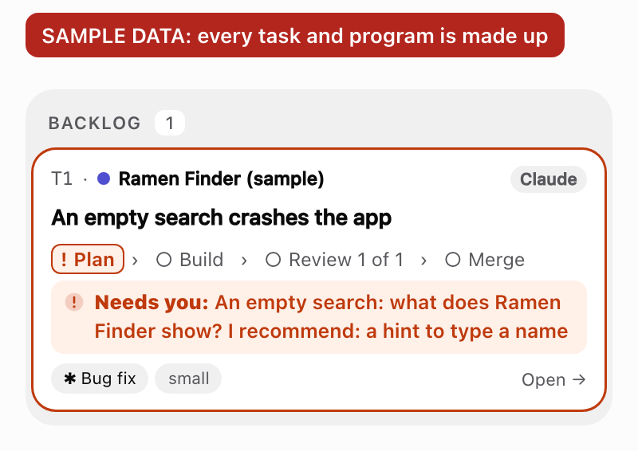
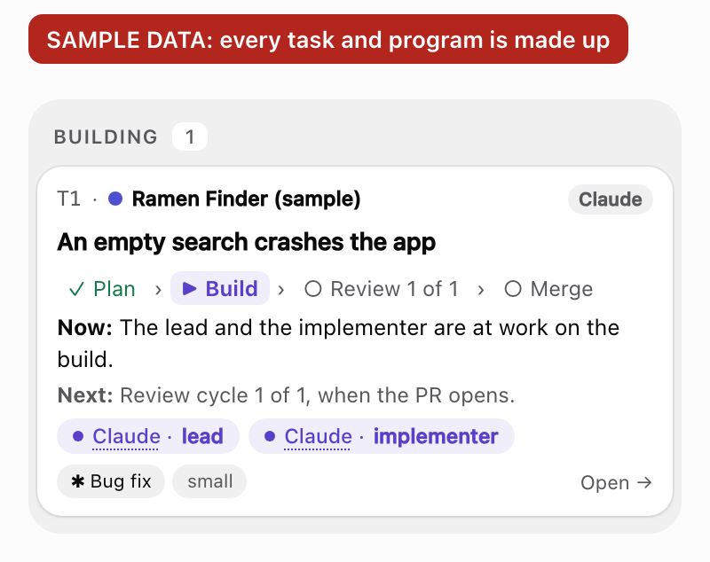
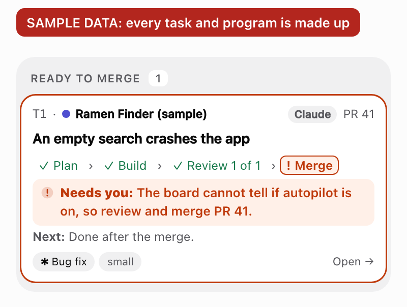
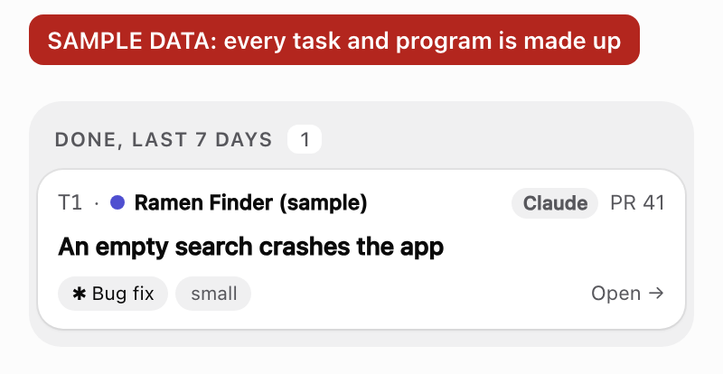

# Learn sage in 5 minutes

This page follows one small task from your first message to a merged pull request. It is a worked example: the project, Ramen Finder, and every task in it are **SAMPLE DATA**.

The board screenshots come from the real board code, with a made-up logbook (`scripts/fixtures/board-walkthrough.mjs`). The chief's own words vary from session to session, so this page describes them. The quoted board text is what the board prints for this sample.

Before you start, install sage with the README's [Quick start](../../README.md#quick-start).

## The loop

<a href="../assets/loop-light.svg">
<picture>
  <source media="(prefers-color-scheme: dark)" srcset="../assets/loop-dark.svg">
  
</picture>
</a>

You talk only to the chief. The chief frames the work, asks you the product questions, and starts the agents. The agents build, review and test, and you get a pull request with evidence.

## One task, start to merge

### 1. Switch sage mode on

In a new Claude Code session in the project's folder, send the on phrase as a message of its own:

```text
sage mode
```

The chief confirms that sage mode is on and waits for your request. A message with other words, such as "sage mode. Fix the crash", switches nothing: the chief asks you to send the exact phrase alone.

### 2. Say what you want

```text
Ramen Finder crashes when I search with an empty box. Fix it.
```

The chief frames one task, T1. It is small (one bounded change) and has no risk flag, so its route is build, code review and QA. A risk flag, such as `input` for a change to how the app reads outside input, adds a security review.

### 3. Answer the one product question

What the app shows for an empty search is a product choice, so the chief asks you once. It asks on a choice card: a question in the chat with options to pick, its recommendation first. The chief also records the question as gate G1, a question that waits for your answer, so the board shows it under "Needs you":



`show board` prints the question in the chat too:

> claude/ramen-finder-a1b2c3/G1 · An empty search: what does Ramen Finder show?\
> Options: 1: a hint to type a name · 2: all ramen shops\
> Recommended: a hint to type a name

You pick option 1. Engineering choices, such as the name of the helper function, are the chief's: it decides and logs them.

### 4. The agents build

The chief starts one lead for the task's pull request: an agent that runs the build, the reviews and the repairs, and reports to the chief once. The lead starts an implementer, which works in its own git worktree. The board shows both at work:



You can leave. The logbook keeps the state, so a later session continues the work. You can also follow and steer it from your phone with [Remote Control](remote-control.md).

### 5. Reviews and QA check it

The implementer opens pull request #41. Fresh agents review it: a code reviewer, and QA, which runs the app and tries to break it. A medium or high finding goes back to an implementer for a repair.

One full set of fresh reviews and QA on one commit is a cycle, and a new commit starts again from cycle 1. T1 needs 1 clean cycle, so its step line shows "Review 1 of 1". A tiny or small task needs 1 clean cycle; a large task, or a task with a risk flag, needs 2 before autopilot merges it.

### 6. The result comes to you

The reviews are clean on the final commit, so the chief reports to you. You get the result, the evidence (the commands that ran, and screenshots), what was not checked, and the pull request. The board says what it needs from you:



> The board cannot tell if autopilot is on, so review and merge PR 41.

You look at the result, not the code. Autopilot is off by default, so you merge.

### 7. Merged

You merge PR #41 on GitHub. The chief then records the merge in the logbook, and the board moves T1 to Done:



To let verified pull requests merge by themselves, send `autopilot on` alone while sage mode is on. The chief then merges each task after its clean cycles, and tells you in one line.

## Try it yourself

Pick one small, real bug in a project that has tests and a GitHub remote. Send `sage mode`, then describe the bug, and look at the result.

<a href="../assets/tip-try-light.svg">
<picture>
  <source media="(prefers-color-scheme: dark)" srcset="../assets/tip-try-dark.svg">
  
</picture>
</a>

## Next

- [Using sage](using-sage.md): every phrase, the four cases in which the chief asks you again, and how to stop a task.
- [How sage works](how-it-works.md): the team, the routes for each task size, and a task's life.
- [The board](board.md): the columns, the cards and the Agents page.
