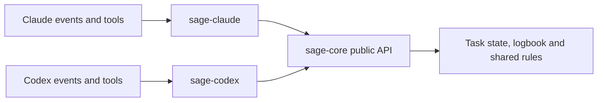

# Sage package boundaries

Sage has one shared rule system and one adapter for each host. The adapters
translate native events into shared operations. Core decides the shared rules;
the adapter translates the result back into the host's response format.

| Package | Owns | Must not own |
| --- | --- | --- |
| `sage-core` | Task states and the state tool, the logbook, board data, role rules and role text, the principles of each role, briefs and reports, the chief's text, command reading and shared policy | Native tool names, host event formats, model names, host configuration paths, installation or hook responses |
| `sage-claude` | Claude identity and events, command fields, native responses, model defaults, hook manifests, launcher and installation | A second implementation of shared task or role rules; Codex code |
| `sage-codex` | Codex transport, identity evidence, event records, command fields, native responses, configuration, hook manifests and installation | A second implementation of shared task or role rules; Claude code |

## Data and authority

A provider verifies the native actor and event before calling core. Model text
cannot select an actor or provide authority. Core receives explicit project,
session, task, run, role, and operation data. Its decisions never depend on a
native event name. Core owns the logbook; a provider owns the native evidence
that ties an actual child to its task and run (the run line of a Claude brief,
or the task name of a Codex child).

Provider settings supply storage roots and supported model defaults. Core does
not read a host's profile or import a host adapter. A project uses one shared
logbook for both providers, or a logbook in each provider's root. The board
reads every provider's logbook.

Shared role and chief text belongs in core. Provider bindings supply commands,
setup, and delivery details. Instructions describe the rules; executable policy
and tests must enforce rules that matter.

## Imports and build output

A provider imports shared code only from `sage-core`. It must not import a core
file by relative path or subpath, or import the other provider. Use ESM imports
and re-exports, including literal dynamic imports; CommonJS `require` of core
is not supported. Core imports its
own modules and platform libraries. Its public entry point is `index.mjs`.

`npm run check` analyzes static imports, re-exports, literal dynamic imports,
and literal require calls with esbuild. It rejects package-boundary violations
without running package code. It also rejects module URLs that could bypass
package resolution. The build uses a pinned ES module lexer to rewrite public
core imports in either quote style, without rewriting comments or string data.
Computed module paths are outside that analysis;
never derive a code path from model text or a native tool request.

The build creates `plugins/sage/` from core plus the Claude adapter, and
`plugins/sage-codex/` from core plus the Codex adapter. Those folders are output,
not another source layer. Tests run each bundle outside the checkout.

## What core holds

Task state, the state tool, the board, role rules and role text, the principles
of each role, brief and report reading, the command reader and the shared
policies live in core. The shared policies are the merge-command reading, the
push rule, the logbook-write rule, the agent `gh` list, the stash and process
rules, the edit rules of the chief and of the read-only roles,
and the mode phrases. Both providers call them.

The shared command policy takes a trusted state-tool path from each provider.
A recognized merge is only a candidate; mode, role and ledger checks still decide
whether it can run. An omitted path grants no state-tool text exception.

The shared push policy receives a synchronous branch reader and a refusal message.
Claude retains its Git invocation and first-upload confirmation flow. Core does
not grant that exception. Missing branch evidence keeps the existing Claude
behavior; Codex must use a reader that throws when it cannot verify the branch.

The Claude hook still holds rules that only Claude can run, such as the agent
caps and the lead's early gap check. Move such a rule into core behind an explicit
operation contract when the other provider needs it. Keep native identity and
event correlation in each provider. Do not move native transport code into core
merely to reduce adapter size.

Migrate a rule with its callers and tests in one pull request; do not keep two
copies, or claim that moving it fixes an open finding.
